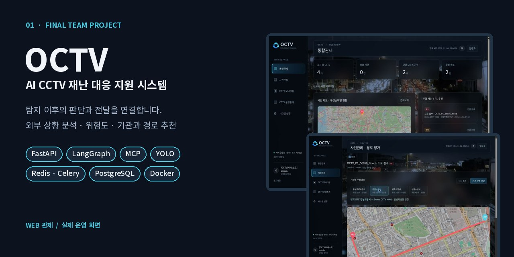
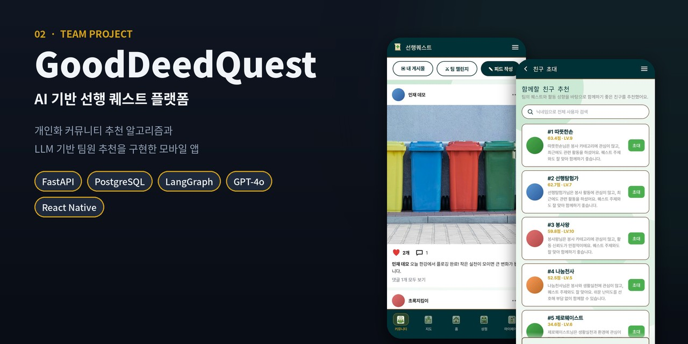
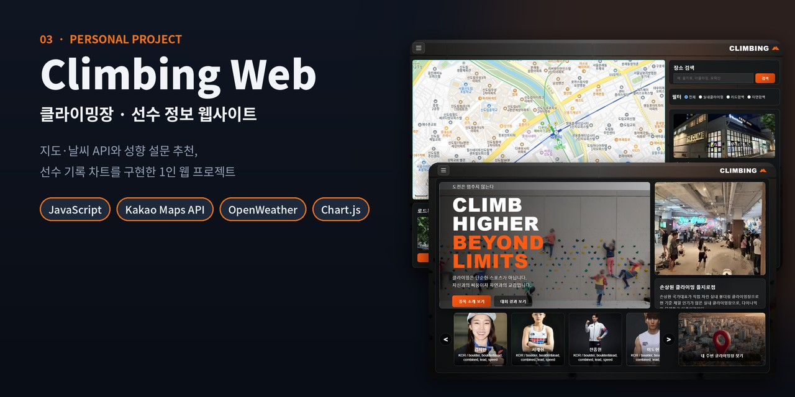

# 이민재 · 포트폴리오

> **최신 공개 포트폴리오:** [portfolio-showcase](https://github.com/alswo0548/portfolio-showcase) · [실제 기능 시연](https://alswo0548.github.io/portfolio-showcase/)
>
> 기존 링크와 작업 이력을 보존하기 위해 이 저장소를 유지합니다.

AI 서비스 · Python 백엔드 개발자 이민재의 대표 프로젝트 3개입니다. 
각 프로젝트는 **소개 페이지(시연 화면 중심) → 기술 상세 문서** 두 단계로 볼 수 있습니다.

| | 프로젝트 | 성격 | 상태 | 바로가기 |
|:-:|---|---|:-:|---|
| 01 | **OCTV** · AI 재난 CCTV 대응 지원 시스템 | 최종 프로젝트 · 2인 · 팀장 | 완료 | [소개](projects/01-octv/README.md) · [기술 상세](projects/01-octv/TECHNICAL.md) |
| 02 | **GoodDeedQuest** · AI 기반 선행 퀘스트 플랫폼 | 중간 프로젝트 · 5인 | 완료 | [소개](projects/02-gooddeedquest/README.md) · [기술 상세](projects/02-gooddeedquest/TECHNICAL.md) |
| 03 | **Climbing Web** · 클라이밍장 · 선수 정보 웹사이트 | 개인 프로젝트 · 1인 | 완료 | [소개](projects/03-climbing-web/README.md) · [기술 상세](projects/03-climbing-web/TECHNICAL.md) |

 

### 01 · OCTV

CCTV로 탐지한 재난 사건의 위험도와 대응 우선순위를 판단하고, 대응 기관·접근 경로 결정을 돕는 관제 플랫폼입니다.
팀장으로 외부 API·MCP 연동, LangGraph 사건 분석, 위험도·기관·경로 추천, 기관 전달·FCM 알림, CCTV 적응학습과 배포 통합을 맡았습니다. **실제 웹 시연 영상 4개**가 있습니다.

[**소개 보기 →**](projects/01-octv/README.md)

 

### 02 · GoodDeedQuest

선행을 게임 퀘스트처럼 수행하는 모바일 앱입니다.
커뮤니티 개인화 추천 알고리즘, LangGraph·GPT-4o 기반 팀원 추천, 관리자 기능을 맡았습니다. **실제 시연 영상 2개**가 있습니다.

[**소개 보기 →**](projects/02-gooddeedquest/README.md)

 

### 03 · Climbing Web

클라이밍 종목 소개, 지도 기반 클라이밍장 찾기와 성향 설문 추천, 선수 기록 차트를 담은 5페이지 웹사이트입니다.
화면 설계부터 HTML · CSS · JavaScript 구현까지 혼자 진행했고, Kakao 지도 · OpenWeather API를 연동했습니다. **실제 시연 영상 3개**가 있습니다.

[**소개 보기 →**](projects/03-climbing-web/README.md)

 

---

이 저장소에는 포트폴리오 문서와 이미지만 있습니다. 원본 코드는 공개된 프로젝트에 한해 각 소개 페이지의 소스코드 링크에서 확인할 수 있습니다.
적용·수정 방법은 [적용 가이드](docs/APPLY_GUIDE.md), 이미지·GIF 규칙은 [관리 규칙](docs/ASSET_GUIDE.md)에 정리했습니다.
