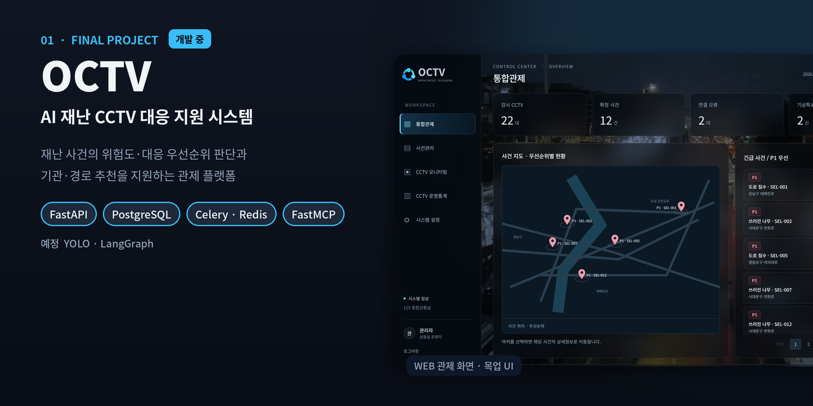
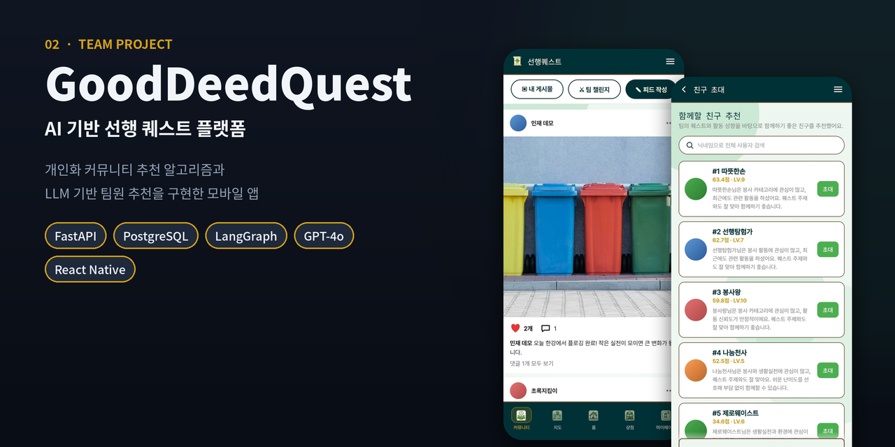

# 이민재 · 포트폴리오

AI 서비스 · Python 백엔드 개발자 이민재의 대표 프로젝트 3개입니다. 
각 프로젝트는 **소개 페이지(시연 화면 중심) → 기술 상세 문서** 두 단계로 볼 수 있습니다.

| | 프로젝트 | 성격 | 상태 | 바로가기 |
|:-:|---|---|:-:|---|
| 01 | **OCTV** · AI 재난 CCTV 대응 지원 시스템 | 최종 프로젝트 · 2인 · 팀장 | 개발 중 | [소개](projects/01-octv/README.md) · [기술 상세](projects/01-octv/TECHNICAL.md) |
| 02 | **GoodDeedQuest** · AI 기반 선행 퀘스트 플랫폼 | 중간 프로젝트 · 5인 | 완료 | [소개](projects/02-gooddeedquest/README.md) · [기술 상세](projects/02-gooddeedquest/TECHNICAL.md) |
| 03 | **Climbing Web** · 클라이밍 주제 개인 웹 | 개인 프로젝트 | 자료 준비 중 | [소개](projects/03-climbing-web/README.md) |

 

### 01 · OCTV

CCTV로 탐지한 재난 사건의 위험도와 대응 우선순위를 판단하고, 대응 기관·접근 경로 결정을 돕는 관제 플랫폼입니다.
DB 설계, 사건 저장·조회 API, 기관별 조회 권한, AI 판단 작업 큐, 외부 API·MCP 연동을 구현했고 판단·추천 기능을 개발하고 있습니다.

[**소개 보기 →**](projects/01-octv/README.md)

 

### 02 · GoodDeedQuest

선행을 게임 퀘스트처럼 수행하는 모바일 앱입니다.
커뮤니티 개인화 추천 알고리즘, LangGraph·GPT-4o 기반 팀원 추천, 관리자 기능을 맡았습니다. **실제 시연 GIF 2개**가 있습니다.

[**소개 보기 →**](projects/02-gooddeedquest/README.md)

 

### 03 · Climbing Web

클라이밍을 주제로 한 개인 웹 프로젝트입니다.
소스코드와 실행 화면을 정리한 뒤, 실제로 확인한 기능과 기술만 공개합니다.

[**소개 보기 →**](projects/03-climbing-web/README.md)

 

---

이 저장소에는 포트폴리오 문서와 이미지만 있습니다. 원본 코드는 각 소개 페이지의 소스코드 링크에서 확인할 수 있습니다.
적용·수정 방법은 [적용 가이드](docs/APPLY_GUIDE.md), 이미지·GIF 규칙은 [관리 규칙](docs/ASSET_GUIDE.md)에 정리했습니다.
