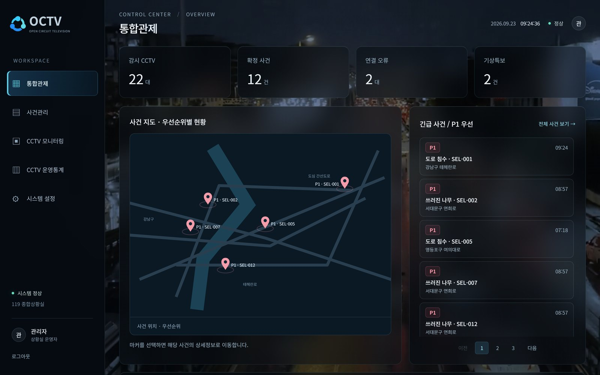
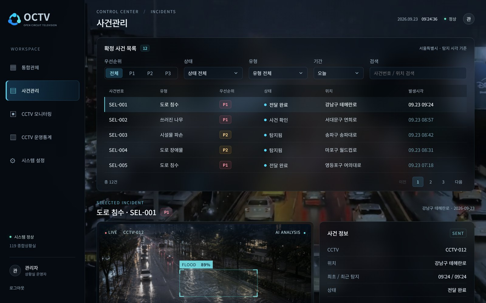
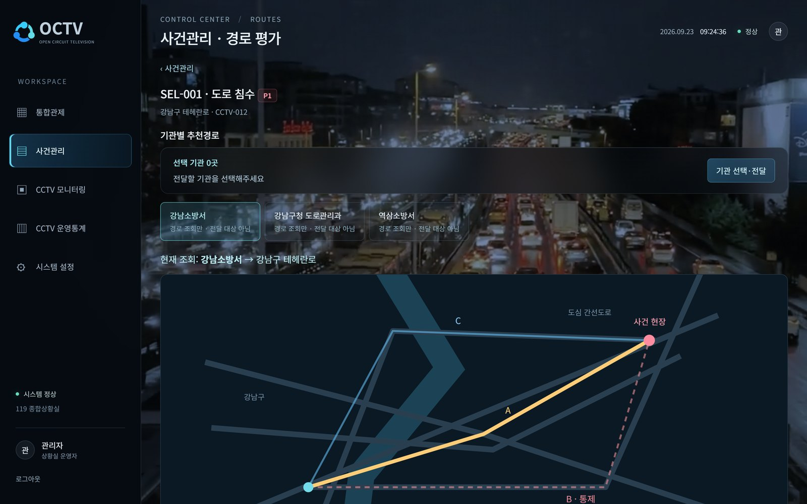

# OCTV · AI 재난 CCTV 대응 지원 시스템

> 여러 지역에서 재난 피해가 동시에 발생할 때, **어디가 위험한지 · 어디부터 대응할지 · 어떤 경로로 접근할지**를
> 관제 요원이 빠르게 판단하도록 돕는 CCTV 기반 의사결정 지원 플랫폼입니다.

`최종 프로젝트` · `2인 팀 · 팀장` · `2026.09 ~ 개발 중`

> [!NOTE]
> **현재 개발 중인 프로젝트입니다.** 화면은 기획을 반영한 **목업 UI**이며 아직 실제 API와 연결되지 않았습니다.
> 아래 [진행 상태](#진행-상태)에서 완료 · 진행 중 · 예정 기능을 구분했습니다.

 

## 화면 미리보기

**통합관제 (WEB 목업)** — 사건 위치를 지도에 표시하고, P1 우선 사건을 목록으로 보여주는 상황실 첫 화면입니다.
화면의 사건·수치는 `shared/src/fixtures.json`의 **목업 데이터**입니다.

<table>
  <tr>
    <td width="50%"></td>
    <td width="50%"></td>
  </tr>
  <tr>
    <td><b>사건관리</b> — 우선순위·상태·유형·기간으로 사건을 거르는 화면. 백엔드 사건 목록 API가 이 필터 구조에 맞춰 구현되어 있습니다.</td>
    <td><b>경로 평가</b> — 대응 기관별 후보 경로(최대 3개)와 통제 구간을 비교하는 화면. 경로 평가 로직은 개발 예정입니다.</td>
  </tr>
</table>

> 실제 동작 시연 GIF는 사건 API와 화면 연결이 끝나면 이 자리에 추가합니다. (촬영 계획은 [기술 상세 문서](TECHNICAL.md#13-다음-시연-자료-계획) 참고)

 

## 어떤 문제를 해결하나요

- 재난 직후 다수의 CCTV를 사람이 동시에 지켜보며 **피해 위치와 심각도**를 파악하기 어렵습니다.
- 같은 피해가 여러 번 탐지되면 **중복 사건**이 쌓여 대응 순서가 흐려집니다.
- 기상·수위·교통 통제 정보가 흩어져 있어 **위험도와 접근 경로**를 함께 판단하기 어렵습니다.

**해결 방향** — AI가 CCTV에서 재난 후보를 탐지하면 하나의 사건으로 통합하고,
외부 데이터와 규칙(Rule)으로 위험도·우선순위를 산정한 뒤, 상황실이 대응 기관과 경로를 골라 전달합니다.

 

## 진행 상태

| 영역 | 기능 | 상태 | 담당 |
|---|---|:---:|:---:|
| DB | PostgreSQL 13개 테이블·ENUM·UNIQUE 7종 설계, 백업 선행 마이그레이션, Atlas 자동화 | ✅ 완료 | **이민재** |
| 사건 | 탐지 후보 저장과 중복 통합(부분 UNIQUE + UPSERT), 사건 목록·상세 API | ✅ 완료 | **이민재** |
| 권한 | 기관 사용자는 전달받은 사건만 조회하도록 범위 제한 | ✅ 완료 | **이민재** |
| 비동기 | Redis · Celery 판단 작업 큐 (판단 함수 연결 전, 설정으로 비활성) | ✅ 골격 완료 | **이민재** |
| 화면 | WEB 관제 · MOBILE 현장 목업 UI 구성, 공통 API 요청·응답 타입 | ✅ 목업 | **이민재** |
| 화면 연동 | 로그인 화면 · WEB 화면과 실제 API 연결 | 🔄 진행 중 | 팀원 수연 |
| 인증 | JWT 로그인 · 역할 기반 인증 | ✅ 완료 | 팀원 수연 |
| 기준 데이터 | 지역 · 소방 · 경찰 · 도로관리 기관 데이터 적재 | ✅ 완료 | 팀원 수연 |
| 외부 데이터 | 기상청 강수량 · 수위 · 교통 Adapter, 관측값 상태 검증, FastMCP 조회 도구 | 🔄 코드 구현 · 실행 설정 연결 전 | **이민재** |
| AI 탐지 | CCTV 캡처 · YOLO 재난 객체 탐지 · 사건화 | 🔄 진행 중 (main 미반영) | 팀원 수연 |
| 판단 | Rule 기반 위험도 · P1/P2/P3 우선순위, LangGraph 판단 흐름 | ⏳ 예정 | **이민재** |
| 추천 | 대응 기관 · 기관별 접근 경로 추천과 전달 | ⏳ 예정 | **이민재** |
| 실시간 | WebSocket 화면 반영 · FCM 모바일 알림 | ⏳ 예정 | **이민재** |

완료 여부는 `main` 브랜치(2026-10-13, 커밋 `52eb02f` 기준)의 코드와 테스트로, 담당은 커밋 이력과 팀 역할 분담 문서로 확인했습니다.

 

## 제가 맡은 부분

**판단 · 대응 영역의 백엔드 전반** — "얼마나 위험하고, 어디부터 어떻게 대응할 것인가"를 담당합니다.

- **DB 설계와 안전한 변경** · 13개 테이블의 제약을 SQL로 직접 관리하고, 기존 DB는 *구조 확인 → 백업 → 백업 검증 → 한 트랜잭션 변경* 순서로만 바꾸도록 만들었습니다.
- **사건 저장 · 조회 API** · 같은 CCTV·유형·위치의 진행 중 사건은 새로 만들지 않고 최근 탐지 시각만 갱신합니다.
- **기관별 조회 권한** · 요청 파라미터의 기관 값은 무시하고 로그인 사용자 기준으로 범위를 정하며, 권한 없는 사건은 존재 여부도 드러내지 않습니다.
- **AI 판단 작업 큐** · 사건 저장과 판단을 분리해, 판단 요청이 실패해도 사건 기록은 유지되게 했습니다.
- **외부 데이터 수집 · MCP** · 기상·수위·교통 API 응답을 출처·단위·관측 시각과 함께 정규화하고, 결측·이상·오래된 값을 구분해 정상 값만 판단에 넘기도록 했습니다. 같은 수집 기능을 FastMCP 도구로도 노출했습니다.

 

## 기술 스택

| 구분 | 기술 |
|---|---|
| Backend | Python 3.12 · FastAPI · Pydantic · psycopg 3 (ORM 없이 SQL 직접 관리) |
| Database | PostgreSQL 17 (Docker) · Atlas 마이그레이션 |
| 비동기 처리 | Redis · Celery |
| Frontend (목업) | React · Vite (WEB) · React Native · Expo (MOBILE) · TypeScript |
| 품질 | unittest · GitHub Actions (PostgreSQL 17 계약 검사 포함) |
| 외부 연동 | httpx · FastMCP (기상청·수위·교통 API) |
| AI (예정·진행) | YOLO · OpenCV · LangGraph |

 

## 더 보기

- 📘 **[기술 상세 문서](TECHNICAL.md)** — 아키텍처, 핵심 코드, 문제 해결 과정, 테스트 결과
- 💻 소스코드 — 현재 비공개 팀 저장소입니다. 공개 전환 후 링크를 추가합니다. <!-- 공개 후 이 줄을 바꾸세요: - 💻 **[소스코드](https://github.com/alswo0548/octv)** — GitHub 저장소 -->
- 🌐 실행 가능한 서비스 링크 — 아직 배포 전이라 없습니다.

 

[← 포트폴리오 목록으로](../../README.md)
