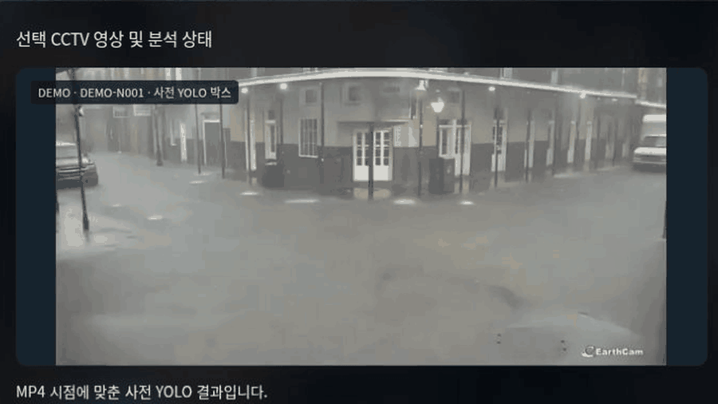
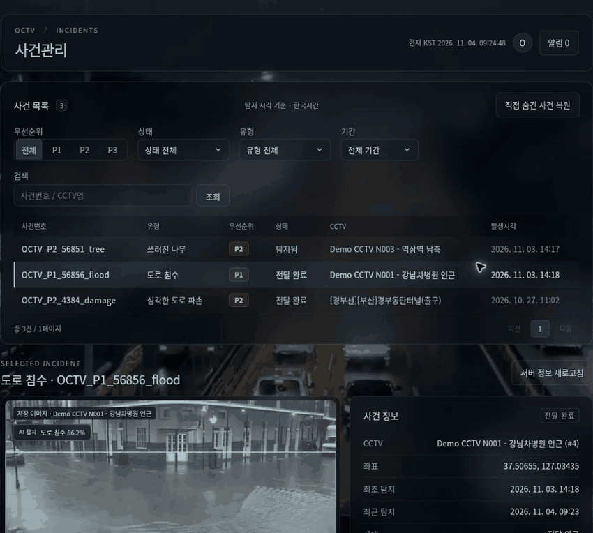
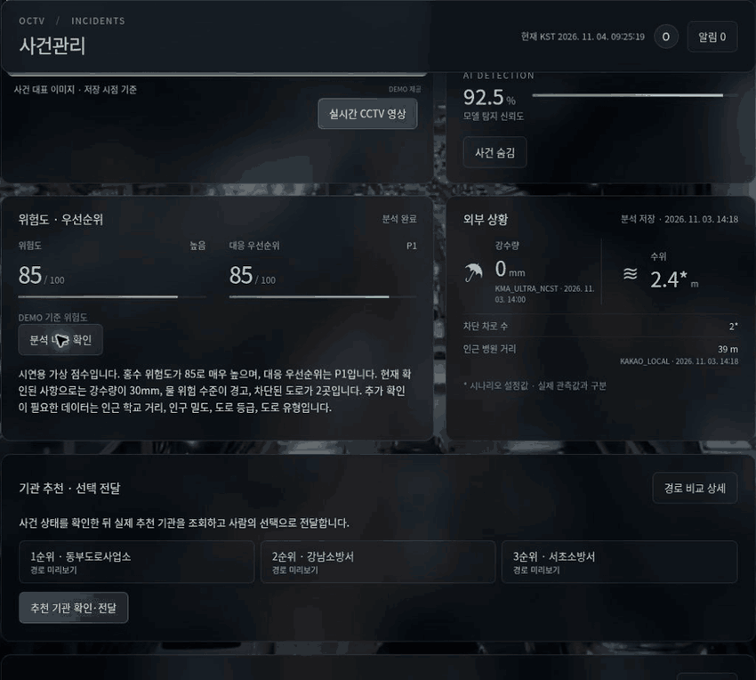
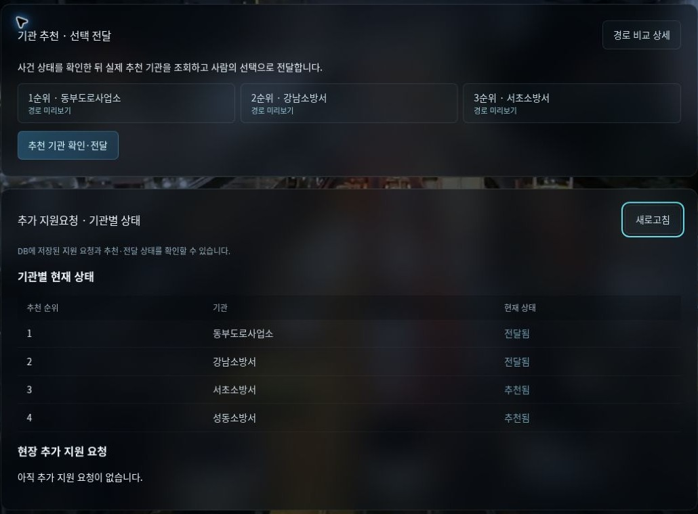

# OCTV · AI 재난 CCTV 대응 지원 시스템

> 여러 지역에서 재난 피해가 동시에 발생할 때, **어디가 위험한지 · 어디부터 대응할지 · 어떤 경로로 접근할지**를
> 관제 요원이 빠르게 판단하도록 돕는 CCTV 기반 의사결정 지원 플랫폼입니다.

`KDT 최종 프로젝트` · `2인 팀 · 팀장` · `2026.09 ~ 2026.11.03` · `최종 발표 완료`

CCTV 탐지 이후 **외부 정보 수집 → 위험도·우선순위 판단 → 대응기관·경로 추천 → 사람의 선택에 따른 기관 전달**을 연결했습니다.
실제 출동 지령이나 현장 대응 완료를 자동화하는 시스템은 아닙니다.

 

## 시연 1 · CCTV 영상과 YOLO 재난 탐지

**무엇을 하나요** — CCTV 영상과 재난 탐지 결과를 함께 보여줍니다. 이 장면은 운영 웹의 **DEMO N001 재생 영상 + 사전 YOLO 추론 결과**입니다.

**이 장면을 보세요**

1. 침수 영상이 재생되고 차량이 이동합니다.
2. 영상 시점에 맞춰 침수 바운딩박스와 탐지 신뢰도가 나타납니다.
3. 신뢰도가 달라지며 영상 재생이 이어집니다.

기존 실제 웹 시연 자료 `OCTV_actual_web_demo.gif`(2026-11-02 KST 보관본)의 연속 CCTV 구간을 사용했습니다. 마지막 별도 지도 장면은 제외했습니다. 이번에 새로 촬영한 영상이나 현재 실시간 도로 재난을 탐지한 장면은 아닙니다.

[탐지·분석 처리 흐름 →](TECHNICAL.md#6-사건-처리-흐름)

 

## 시연 2 · 사건 상세 → 외부 상황과 위험도 판단

**무엇을 하나요** — 저장된 탐지 이미지, 사건 정보, 외부 데이터의 출처·관측 시각, 위험도와 P1/P2/P3 우선순위를 한 화면에서 확인합니다.

**이 장면을 보세요**

1. 저장된 침수 사건과 대표 탐지 이미지를 확인합니다.
2. 아래로 이동해 위험도·우선순위와 외부 상황을 비교합니다.
3. **분석 내용 확인**을 눌러 판단 설명을 펼칩니다.

> **시연 데이터 구분** — 85점·P1, 수위 `2.4*`, 차단 차로 `2*`는 DEMO 시나리오입니다. 강수량 카드 `0 mm`는 출처·시각이 표시된 관측값입니다. 분석 설명의 `30 mm`는 시나리오 문구이므로 현재 관측값으로 해석하면 안 됩니다.

[외부 데이터 검증과 위험도 계산 →](TECHNICAL.md#8-핵심-구현)

 

## 시연 3 · 대응기관별 후보 경로 비교

**무엇을 하나요** — 추천 기관에서 사건 위치까지의 후보 경로를 지도·거리·시간·점수와 함께 비교해 관제 요원의 선택을 돕습니다.

**이 장면을 보세요**

1. **경로 비교 상세**로 이동해 추천 기관과 지도 경로를 확인합니다.
2. 동부도로사업소의 **후보 2**를 선택해 거리·시간·판정을 비교합니다.
3. **강남소방서** 탭으로 바꿔 다른 기관의 접근 경로를 확인합니다.

> 화면의 ‘시연 51분·48.8점’은 가상 교통상황이며 원본 API 시간·거리와 구분됩니다. **추가 확인 필요**는 통제 정보가 검증되지 않았다는 뜻입니다. 최단·최안전 경로나 실제 출동 가능성을 보장하지 않습니다.

[기관 선정과 경로 평가 →](TECHNICAL.md#8-핵심-구현)

 

## 대응 지원 · 기관 전달 상태

관제 요원이 기관을 선택해 사건을 전달하고 기관별 상태를 확인합니다. 서버에는 **알림 저장·FCM 발송·실패 대상 재시도**를 구현했습니다.
위 화면은 **기존 전달 기록을 조회한 정지 화면**입니다. 이번 촬영에서는 기관 전달·알림 발송을 실행하지 않았으며, 모바일 기기의 실제 수신도 검증하지 않았습니다. ‘전달됨’은 출동 지령·현장 대응 완료를 뜻하지 않습니다.

 

## 어떤 문제를 해결하나요

- 다수의 CCTV에서 발생한 피해를 사건 단위로 모아 **위치와 우선순위**를 확인합니다.
- 기상·수위·교통·주변 시설 정보를 정규화하고, 결측·오래된 값·미검증 정보를 구분합니다.
- 위험도와 기관·경로 추천 근거를 함께 제시해 **탐지 이후의 대응 의사결정**을 지원합니다.

 

## 최종 구현 범위와 담당 역할

| 영역 | 최종 구현 | 담당 |
|---|---|---|
| CCTV·탐지 | CCTV 수집·스트리밍·모니터링, YOLO 재난 탐지와 사건 생성 | 팀원 중심 |
| 외부 정보 | 기상·수위·교통 API 연동, 정규화·매핑·캐시, MCP 조회 도구 | **이민재** |
| 사건 분석 | LangGraph 7단계 흐름, 규칙 기반 위험도·P1/P2/P3 판단 | **이민재** |
| 추천 | 대응기관 선정, 후보 경로 조회·평가·재정렬 | **이민재** |
| 대응 지원 | 기관 전달, FCM 알림·중복 방지·재시도 | **이민재** |
| 모델·통합 | CCTV 환경 적응학습 모델 개발, Docker 배포·서비스 통합 | **이민재** |

**제가 맡은 부분** — 팀장으로서 외부 데이터와 사건 분석·대응 지원 백엔드를 연결했습니다. 탐지·사건 생성은 팀원의 주 담당 영역이며, 제가 담당한 사건 저장·조회·권한·판단 큐 기반과 통합했습니다. 적응학습은 별도 학습 환경에서 수행한 역할로, 저장소의 학습 진입점까지 완성된 자동 학습 파이프라인을 의미하지 않습니다.

 

## 기술 스택

| 구분 | 기술 및 사용 범위 |
|---|---|
| Backend | Python · FastAPI · Pydantic · psycopg — API·검증·SQL 저장 |
| Database | PostgreSQL · Atlas 마이그레이션 |
| 비동기 처리 | Redis · Celery — 분석/알림 작업 분리·락·캐시 |
| 사건 분석 | LangGraph — 상태 기반 처리 흐름 / FastMCP — 외부 상황 조회 도구 |
| 탐지·영상 | YOLO · OpenCV · MediaMTX · WebRTC / DEMO MP4·추론 JSON 표시 |
| Frontend | React · Vite · TypeScript (WEB), React Native · Expo (MOBILE) |
| 외부 연동 | 기상·수위·교통 API, Kakao Local·Mobility, Firebase Cloud Messaging |
| 배포 | Docker Compose · Caddy · DigitalOcean |

 

## 더 보기

- 📘 **[기술 상세 문서](TECHNICAL.md)** — 아키텍처, 판단 규칙, 비동기 처리, 문제 해결과 검증 범위
- 🌐 **[운영 웹사이트](https://209-97-168-207.sslip.io)** — 로그인 필요, 외부 API·CCTV 연결 상태에 따라 표시가 달라질 수 있습니다.
- 💻 **[소스코드](https://github.com/alswo0548/octv)** — 비공개 팀 저장소로 접근 권한이 필요합니다.

시연 2·3과 전달 상태·통합관제 이미지는 2026-11-04 운영 웹에서 기존 사건을 조회하며 새로 촬영했습니다. GIF는 연속 화면 캡처를 시간순으로 변환하고 대기 구간을 줄였으며, 계정 영역을 크롭했습니다. UI·탐지 결과를 합성하지 않았습니다. 세 GIF는 각각 독립된 장면으로 하나의 실시간 탐지→전달 실행을 입증하는 영상은 아닙니다.

 

[← 포트폴리오 목록으로](../../README.md)
