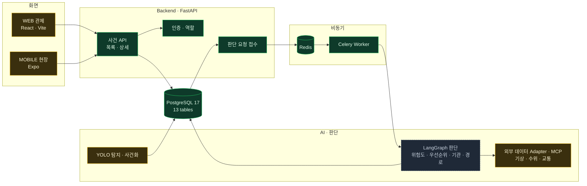
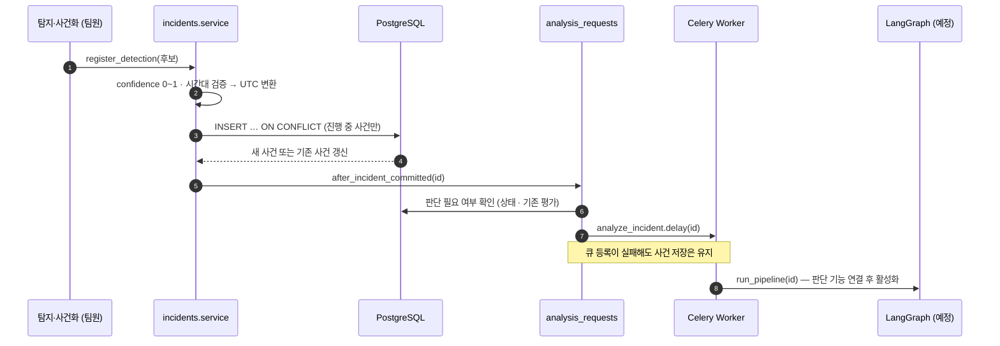
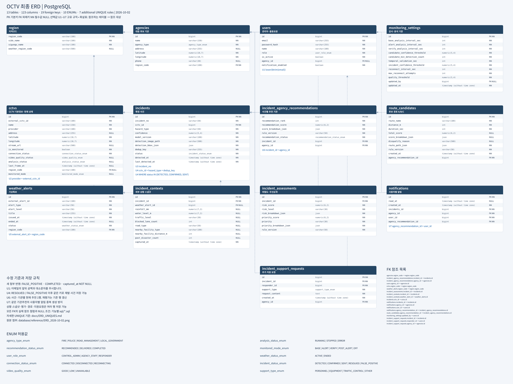

# OCTV 기술 상세

[← OCTV 소개로](README.md) · 소스코드: 비공개 팀 저장소 <!-- 공개 전환 후: [소스코드](https://github.com/alswo0548/octv) -->

> 이 문서는 `main` 브랜치(2026-10-13, 커밋 `52eb02f`) 기준입니다. 구현된 내용과 계획을 섞지 않기 위해
> 모든 항목에 **완료 · 진행 중 · 예정**을 표시했습니다.

### 목차

1. [개요와 개발 배경](#1-개요와-개발-배경)
2. [해결하려는 문제와 목표](#2-해결하려는-문제와-목표)
3. [기간 · 인원 · 담당 역할](#3-기간--인원--담당-역할)
4. [기술 스택과 선정 이유](#4-기술-스택과-선정-이유)
5. [시스템 아키텍처](#5-시스템-아키텍처)
6. [사건 처리 흐름](#6-사건-처리-흐름)
7. [데이터베이스와 API](#7-데이터베이스와-api)
8. [핵심 코드](#8-핵심-코드)
9. [기술적 문제와 해결](#9-기술적-문제와-해결)
10. [테스트와 검증](#10-테스트와-검증)
11. [배운 점과 개선할 부분](#11-배운-점과-개선할-부분)
12. [향후 계획](#12-향후-계획)
13. [다음 시연 자료 계획](#13-다음-시연-자료-계획)

---

## 1. 개요와 개발 배경

OCTV(Open Circuit TeleVision)는 재난 이후 CCTV 영상에서 피해 후보를 찾고, 그 사건을 **얼마나 위험한지·어디부터 대응할지·어떤 경로로 접근할지** 판단하도록 돕는 관제 플랫폼입니다.
119 종합상황실을 위한 **WEB**과 현장 대원을 위한 **MOBILE** 두 화면을 가정해 설계했습니다.

## 2. 해결하려는 문제와 목표

| 문제 | 목표 |
|---|---|
| 침수·쓰러진 나무·시설물 파손이 여러 지역에서 동시에 발생하면 다수의 CCTV를 사람이 함께 보기 어렵다 | AI가 재난 후보를 탐지하고 사건 단위로 정리 |
| 같은 피해가 반복 탐지되면 사건이 중복되어 대응 순서가 흐려진다 | 진행 중 사건은 DB 제약으로 하나만 유지 |
| 기상·수위·교통 통제 정보가 흩어져 있다 | 외부 데이터와 Rule로 위험도·우선순위를 산정하고 근거를 함께 제공 |
| 접근 경로가 통제·위험 구간을 지날 수 있다 | 기관별 후보 경로를 평가해 상황실이 비교·선택 |

## 3. 기간 · 인원 · 담당 역할

- **기간** · 2026.09.27 첫 커밋 ~ 개발 중
- **인원** · 2명 — 이민재(팀장), 수연(팀원)
- **협업** · 기능 브랜치 → PR → 상대방 확인 후 병합 (PR #1 ~ #16)

| 담당자 | 영역 | 저장소에 반영된 작업 |
|---|---|---|
| **이민재** | 판단 · 대응 (Backend · DB · 외부 데이터 · Rule · 추천 · 실시간 연동) | DB 스키마·마이그레이션, 사건 API, 기관별 권한, 판단 작업 큐, 외부 API Adapter·MCP 도구, 목업 UI 정리, 공통 API 클라이언트, CI |
| 수연 | 탐지 · 사건화 (CCTV 캡처 · YOLO 추론 · 사건 후보 생성) · 인증 | 역할 기반 JWT 인증, 지역·기관 기준 데이터 적재 |

> 역할 범위는 팀의 역할 분담 문서, 실제 작업은 Git 커밋 작성자 기준입니다.

## 4. 기술 스택과 선정 이유

| 기술 | 선정 이유 |
|---|---|
| **FastAPI** | 요청·응답 형식을 Pydantic으로 검증하고, `/docs`에서 팀원과 API 계약을 바로 확인할 수 있어서 |
| **PostgreSQL 17** | 부분 UNIQUE 인덱스, `LATERAL` 조인, 표현식 인덱스처럼 **데이터 규칙을 DB에서 강제**하는 기능이 필요해서 |
| **psycopg 3 + 직접 작성한 SQL** | 제약과 쿼리를 SQL 원본 한 곳에서 관리하기 위해 ORM을 쓰지 않음. 파라미터 바인딩으로만 값을 전달 |
| **Redis + Celery** | 사건 저장 응답과 시간이 걸리는 AI 판단을 분리하고, 실패 시 재시도를 대기열에 맡기기 위해 |
| **Atlas** | 마이그레이션 SQL의 이력과 체크섬(`atlas.sum`)을 관리해 팀원 간 DB 구조 차이를 줄이기 위해 |
| **GitHub Actions** | 프론트 빌드·타입 검사, Python 테스트, PostgreSQL 17 계약 검사를 PR마다 실행 |
| **FastMCP** | 외부 데이터 조회를 표준 도구(`get_incident_context`)로 노출해, 판단 단계가 어떤 방식으로 데이터를 가져오든 같은 계약을 쓰게 하기 위해 |
| LangGraph *(예정)* | 위험도 → 우선순위 → 기관 → 경로 판단을 단계별 노드로 나누기 위해 |

## 5. 시스템 아키텍처



<sub>초록 = 완료 · 노랑 = 진행 중(목업·학습·Adapter 작업) · 회색 점선 = 예정</sub>

## 6. 사건 처리 흐름



| 단계 | 상태 |
|---|---|
| 1~4 탐지 후보 검증 · 저장 · 중복 통합 (`register_detection`) | ✅ 구현 · 테스트 완료 |
| 5 저장 직후 판단 요청 자동 호출 (`after_incident_committed`) | 🔄 함수 구현, 탐지 Worker와 연결 전 |
| 6~7 판단 필요 여부 확인 · Celery 큐 등록 (`request_analysis`) | ✅ 구현 (관리자 수동 요청 API로 사용 가능) |
| 8 LangGraph 판단 실행 (`run_pipeline`) | ⏳ 예정 |

- **판단 기능 스위치** · `OCTV_DECISION_ENABLED=1`일 때만 큐에 등록합니다. 판단 함수가 완성되기 전에 잘못된 결과가 저장되지 않게 하려는 장치입니다.
- **관리자 재요청** · `POST /api/incidents/{id}/analysis`로 관제 관리자가 판단을 다시 요청할 수 있습니다. (202 응답)

## 7. 데이터베이스와 API

### ERD



- 13개 테이블 · 123개 컬럼 · FK 19개 · ENUM 10종 · UNIQUE 규칙 7개 (2026-10-02 최종 ERD 기준. 이후 Atlas 마이그레이션으로 기관 담당 지역코드 컬럼 추가 등 일부 변경)
- 기능별로 SQL을 나누어 관리합니다 (`backend/app/<기능>/sql/*.sql`). 초기화 진입점은 `database/schema.sql` 하나입니다.

| UNIQUE 규칙 | 의미 |
|---|---|
| `users (lower(btrim(email)))` | 공백·대소문자만 다른 이메일 중복 가입 방지 (표현식 인덱스) |
| `incidents (cctv_id, hazard_type, dedup_key) WHERE status IN ('DETECTED','CONFIRMED','SENT')` | **진행 중**인 같은 사건은 하나만. 종결 후 재발은 새 사건으로 허용 (부분 인덱스) |
| `incident_agency_recommendations (incident_id, agency_id)` | 사건·기관별 현재 추천은 1행, 재평가는 갱신 |
| `notifications (agency_recommendation_id, user_id)` | 같은 추천 알림은 사용자당 1회 |

### API (사건 영역)

| Method | Path | 권한 | 상태 |
|---|---|---|:---:|
| GET | `/api/incidents` | 로그인 사용자 (기관 사용자는 전달받은 사건만) | ✅ |
| GET | `/api/incidents/{id}` | 로그인 사용자 (권한 없으면 404) | ✅ |
| POST | `/api/incidents/{id}/analysis` | 관제 관리자 | ✅ |
| GET · PATCH | CCTV · 알림 · 설정 · 통계 · 지원 요청 | — | ⏳ 501 (예정) |

목록 API는 우선순위·상태·유형·지역·CCTV·기간·검색어·진행 중 여부로 필터링하고,
**평가 우선순위 점수가 높은 순 → 탐지 시각 → ID 순**으로 정렬해 페이지가 바뀌어도 순서가 흔들리지 않게 했습니다.

## 8. 핵심 코드

### ① 중복 탐지를 하나의 사건으로 통합 — `incidents/repository.py`

```python
INSERT INTO incidents (incident_no, cctv_id, hazard_type, confidence, ...,
                       dedup_key, detected_at, last_detected_at)
VALUES (...)
ON CONFLICT (cctv_id, hazard_type, dedup_key)
    WHERE status IN ('DETECTED', 'CONFIRMED', 'SENT')
DO UPDATE SET
    last_detected_at = GREATEST(incidents.last_detected_at, EXCLUDED.last_detected_at)
RETURNING *
```

- 부분 UNIQUE 인덱스와 같은 조건으로 `ON CONFLICT`를 걸어, **진행 중인 같은 사건**이면 새 행 대신 최근 탐지 시각만 갱신합니다.
- `GREATEST`로 늦게 도착한 과거 탐지가 최근 시각을 되돌리지 못하게 했습니다.
- 애플리케이션에서 "먼저 조회 후 저장"하면 동시 요청에서 중복이 생길 수 있어, 판단을 DB 한 문장에 맡겼습니다.

### ② 기관별 조회 범위 강제 — `incidents/service.py`, `repository.py`

```python
# service.py — 요청에 섞인 기관 조건은 버리고, 로그인 사용자로 범위를 정한다
values.pop("agency_id", None)
values.pop("agency_active_only", None)
if user["role"] != "CONTROL_ADMIN":
    values["agency_id"] = user.get("agency_id")
```

```python
# repository.py — 기관에 실제 전달된 사건만, EXISTS로 중복 행 없이
EXISTS (
    SELECT 1 FROM incident_agency_recommendations ar
    WHERE ar.incident_id = i.id
      AND ar.agency_id = %s
      AND ar.recommendation_status IN ('DELIVERED', 'COMPLETED')
)
```

- 클라이언트가 `?agency_id=999`를 보내도 서버가 무시합니다.
- 기관이 지정되지 않은 사용자는 `FALSE` 조건으로 0건을 반환합니다.
- 상세 조회는 **사건을 읽기 전에** 전달 관계부터 확인하고, 권한이 없으면 403이 아닌 404로 응답해 사건 존재 여부를 노출하지 않습니다.
- JOIN 대신 `EXISTS`를 써서 한 사건이 여러 추천 행과 연결돼도 목록에 중복으로 나오지 않습니다.

### ③ 사건마다 최신 평가 1건만 붙이기 — `LEFT JOIN LATERAL`

```sql
LEFT JOIN LATERAL (
    SELECT * FROM incident_assessments a
    WHERE a.incident_id = i.id
    ORDER BY a.id DESC
    LIMIT 1
) a ON TRUE
```

평가는 재수집·재평가로 여러 번 쌓일 수 있어, 사건 1행에 가장 최근 평가만 붙입니다. 평가가 없는 사건도 목록에서 빠지지 않습니다.

### ④ 판단 작업 큐 — `workers.py`

```python
celery_app.conf.update(
    task_acks_late=True,              # 작업이 끝난 뒤 완료 확인
    task_reject_on_worker_lost=True,  # Worker가 죽으면 작업을 대기열로 되돌림
    worker_prefetch_multiplier=1,     # 미리 가져가는 작업 수 제한
    task_time_limit=240,
)

# 재시도 시 원문 예외 대신 예외 이름만 남긴다 (URL · API 키 노출 방지)
raise self.retry(exc=RuntimeError(type(exc).__name__), countdown=30)
```

### ⑤ 외부 데이터는 "값"이 아니라 "상태"로 넘기기 — `integrations/normalization.py`

```python
def measurement(value, observed_at, source, unit, now, max_age_sec):
    base = {"value": None, "observed_at": None, "source": source, "unit": unit}
    if value is None or observed_at is None:
        return {**base, "status": "NO_DATA"}          # 결측
    if observed_at.tzinfo is None or now.tzinfo is None:
        raise ValueError("외부 시각에는 시간대가 필요합니다.")
    if isinstance(value, (int, float)) and (not isfinite(value) or value < 0):
        return {**base, "status": "INVALID"}          # NaN · 무한대 · 음수
    age = (now - observed_at).total_seconds()
    status = "OK" if 0 <= age <= max_age_sec else "STALE"   # 오래된 관측값
    ...
```

- 기상청 강수량(RN1) · 수위 · 교통 Adapter가 모두 이 함수를 거쳐 **출처 · 단위 · 관측 시각 · 상태**를 함께 반환합니다.
- 다음 판단 단계는 `status == "OK"`인 값만 사용하도록 해, 오래되거나 잘못된 외부 값이 위험도 계산에 섞이지 않게 했습니다.
- 수집 결과는 `ContextSnapshot`으로 묶어 FastMCP 도구 `get_incident_context`로도 조회할 수 있습니다. (현재는 같은 Python 프로세스 안의 in-memory 연결)

## 9. 기술적 문제와 해결

| # | 문제 | 시도와 해결 | 결과 |
|:-:|---|---|---|
| 1 | 같은 피해가 프레임마다 탐지되면 사건이 계속 늘어남 | 진행 중 상태에만 적용되는 **부분 UNIQUE 인덱스** + 같은 조건의 `ON CONFLICT` | 진행 중 사건은 1건 유지, 종결 후 재발은 새 사건으로 저장 |
| 2 | 기관 사용자가 쿼리 파라미터로 다른 기관 사건을 조회할 위험 | Service에서 요청 값 제거 후 사용자 기준 재설정, 상세는 조회 전 권한 확인, 404 응답 | 권한 우회 시나리오를 테스트로 고정 |
| 3 | 목록 총 개수와 실제 페이지가 서로 다른 조건으로 계산될 위험 | count 쿼리와 페이지 쿼리가 **같은 WHERE 문자열**을 공유하도록 구성 | 두 쿼리의 SQL·파라미터가 같은지 테스트로 확인 |
| 4 | 기존 개인 DB를 새 ERD로 바꿀 때 데이터가 손실될 위험 | 구조 확인 → 전체 백업 → 백업 읽기 확인 → 변경을 **한 트랜잭션**으로 실행, 실패 시 전체 rollback | 이미 최신 구조면 실행하지 않고 종료 |
| 5 | 백업 확인이 안 됐는데 psql이 정상 종료 코드로 끝남 (`\quit 3`이 오류 종료를 보장하지 않음) | CI의 PostgreSQL 17에서 발견 → **SQL 예외**로 바꿔 확실히 실패하도록 수정 | 백업 변수 누락·false 모두 변경 전에 중단 |
| 6 | 한국어 Windows에서 `pip install` 시 `cp949` 디코딩 오류 | requirements 파일 인코딩을 UTF-8로 명시하고 CP949 환경을 CI에서 재현 | 팀원 PC 설치 오류 해결 |
| 7 | AI 판단 실패가 사건 저장까지 실패시키면 탐지 기록을 잃음 | 저장 트랜잭션 완료 **후에** 큐에 등록하고, 등록 실패는 로그만 남기는 `after_incident_committed` 작성 | 판단과 저장의 장애 범위를 분리 (탐지 Worker 연결 시 적용 예정) |

## 10. 테스트와 검증

| 검증 | 결과 | 비고 |
|---|---|---|
| Python unittest (`tests/`) | **30개 통과** | 2026-10-13 `52eb02f`에서 로컬 실행. 인증·사건 권한·API 목록·DB 설정·마이그레이션 실패 경로 |
| 공통 API 클라이언트 (`node --test`) | **24개 통과** | 2026-10-13 로컬 실행. WEB·MOBILE 토큰 갱신·오류 처리 |
| PostgreSQL 17 계약 검사 (CI) | 신규 DDL · UNIQUE 동작 · 기존 DB 갱신 · 오류 rollback | GitHub Actions의 PostgreSQL 17.11 서비스 컨테이너 |
| 프론트 빌드 (CI) | typecheck · Prettier · WEB 빌드 · Expo 웹 export | PR마다 실행 |

사건 권한 테스트에서 확인하는 시나리오 예시:

- 기관 사용자가 다른 기관 ID를 넣어도 본인 기관으로 조회된다
- 권한 없는 사건 상세는 **사건 데이터를 읽기 전에** 404를 반환한다
- 기관이 없는 사용자는 목록·상세 모두 0건이다
- 목록의 개수 쿼리와 페이지 쿼리가 같은 범위를 사용한다
- 시간대 없는 날짜 입력은 422로 거절한다

<sub>성능 수치나 실제 CCTV 대상 정확도는 아직 측정하지 않았습니다. 모델 지표는 학습이 끝난 뒤 추가합니다.</sub>

## 11. 배운 점과 개선할 부분

**배운 점**

- 권한·중복 같은 규칙은 코드 여러 곳에 흩어 두는 것보다 **DB 제약과 한 곳의 Service**에 모아야 테스트하기 쉽고 우회가 어렵습니다.
- 개발 중인 기능은 501 응답·설정 스위치로 "아직 안 됨"을 명확히 드러내야 팀원과 화면 개발이 잘못된 가정을 하지 않습니다.
- 마이그레이션은 "실행된다"보다 "실패할 때 안전하게 멈춘다"를 먼저 검증해야 한다는 것을 CI에서 직접 겪었습니다.

**개선할 부분**

- 화면이 아직 목업 데이터를 쓰고 있어, 사건 API와의 통합 검증이 필요합니다.
- 판단 결과(위험도·우선순위)의 **근거**를 함께 저장하는 구조는 설계했지만(`*_breakdown_json`), 산정 규칙은 아직 구현 전입니다.
- 실제 Docker PostgreSQL 대상 통합 테스트를 로컬에서도 자동으로 돌리는 환경이 필요합니다.
- 외부 API Adapter와 MCP 도구는 코드만 반영됐고 자동 테스트가 아직 없습니다. 응답 예시를 고정한 단위 테스트가 필요합니다.

## 12. 향후 계획

1. 외부 데이터 수집의 실행 설정(API 요청 생성) 연결과 Adapter 테스트 보강 — *코드 구현 완료, 연결 진행 중*
2. Rule 기반 위험도·P1/P2/P3 우선순위 산정과 근거 저장
3. LangGraph로 위험도 → 우선순위 → 후보 기관 → 기관별 경로 평가 흐름 연결
4. 상황실의 기관 선택·전달, 현장 MOBILE의 사건 확인·추가 대응 요청
5. 권한별 WebSocket 실시간 반영과 FCM 모바일 알림
6. 기상특보 수신 Scheduler와 GPU 제어 요청 연동

## 13. 다음 시연 자료 계획

기능이 연결되면 아래 장면을 GIF로 촬영해 소개 페이지 상단에 추가합니다. 파일 규칙은 `assets/01-octv/NN_기능명.gif`입니다.

| 파일명 | 촬영 장면 | 촬영 가능 시점 |
|---|---|---|
| `01_incident_scope.gif` | 관제 관리자와 기관 사용자로 각각 로그인해 사건 목록 범위가 달라지는 장면 (WEB) | 사건 API와 WEB 연결 후 |
| `02_dedup_upsert.gif` | 같은 CCTV 사건이 반복 탐지돼도 목록에 1건으로 남고 최근 탐지 시각만 바뀌는 장면 | 탐지 Worker 연결 후 |
| `03_risk_priority.gif` | 판단 요청 → 위험도·우선순위와 근거가 화면에 반영되는 장면 | Rule · LangGraph 구현 후 |
| `04_agency_route.gif` | 기관별 후보 경로 비교 → 기관 선택 · 전달 → MOBILE 알림 수신 | 경로 평가 · FCM 구현 후 |

[← OCTV 소개로](README.md) · [포트폴리오 목록으로](../../README.md)
