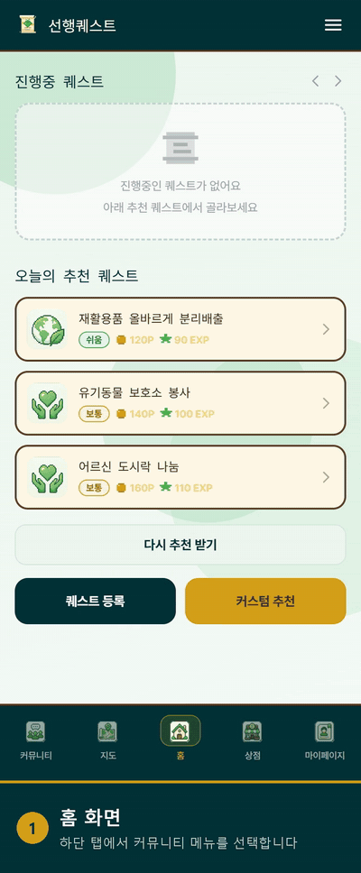

# GoodDeedQuest · AI 기반 선행 퀘스트 플랫폼

> 하고 싶지만 실천으로 잘 이어지지 않는 선행을 **게임 퀘스트·레벨·보상** 구조로 바꾼 모바일 앱입니다.
> 저는 **커뮤니티 개인화 추천**, **팀 챌린지와 LLM 기반 팀원 추천**, **관리자 대시보드**를 맡았습니다.

`중간 프로젝트` · `5인 팀` · `2026.06.26 ~ 2026.08.11` · `팀명: 퀘스트 지상주의`

 

## 시연 1 · 커뮤니티 추천 알고리즘 갱신

<table>
<tr>
<td width="40%" valign="top"></td>
<td valign="top">

**무엇을 하나요** 
게시글마다 **관심 카테고리 · 지역 · 최신성 · 반응도 · 작성자 신뢰도**를 합산한 100점 점수로 피드를 정렬합니다.
당겨서 새로고침하면 추천 API를 다시 호출해 점수를 재계산하고, 상위 3개 게시글의 노출 순서를 순환시킵니다.

**이 장면을 보세요**
1. 홈 → 커뮤니티 탭에서 추천 피드 API 호출
2. 점수 1위 게시글 *민재 데모* 가 맨 위에 표시
3. 새로고침마다 첫 게시글이 *초록지킴이 → 매일한걸음* 으로 변경
4. 세 번째 새로고침에서 처음 순서로 돌아옴 (상위 3개만 순환)

**구현 포인트**
- 점수 계산은 DB에 접근하지 않는 순수 함수로 분리 (`community/scoring.py`)
- '관심 없음' 처리한 게시글은 추천 후보에서 제외

[고화질 MP4](../../assets/02-gooddeedquest/01_community_algorithm.mp4) · [알고리즘 상세 →](TECHNICAL.md#6-1-커뮤니티-개인화-추천-피드)

</td>
</tr>
</table>

 

## 시연 2 · 팀 챌린지 생성 → AI 팀원 추천(LLM) → 초대

<table>
<tr>
<td width="40%" valign="top"></td>
<td valign="top">

**무엇을 하나요** 
팀장이 방을 만들고 **친구 초대**를 누르면, 백엔드가 초대 가능한 후보와 최근 30일 활동을 AI 서버로 보냅니다.
LangGraph가 후보 점수를 계산해 상위 5명을 고르고, **GPT-4o가 친구별 추천 이유**를 생성합니다.

**이 장면을 보세요** (하단 자막 번호와 같음)
1. 홈 → 커뮤니티 → 팀 챌린지
2. 방 만들기: 팀 이름 · 수행 퀘스트 · 활동 지역 입력 후 생성
3. **⑤ 친구 초대** — AI 서버의 LangGraph 실행 (LLM 대기 구간 4배속)
4. **⑥ LLM 응답 반영** — 카드마다 GPT-4o가 쓴 추천 이유와 점수
5. 1순위 친구 초대 → 완료 알림, 목록에서 제외

**확인한 사실**
- 녹화 당시 API 응답 5건 모두 `reason_source: "LLM"`, 경고 0건
- LLM이 실패하면 규칙 기반 문구로 대체되도록 구현

[고화질 MP4](../../assets/02-gooddeedquest/02_team_challenge_llm.mp4) · [추천 파이프라인 상세 →](TECHNICAL.md#6-2-팀-챌린지--ai-팀원-추천)

</td>
</tr>
</table>

 

## 어떤 문제를 해결하나요

- 선행을 하고 싶어도 **무엇을, 어디서** 할 수 있는지 알기 어렵습니다.
- 봉사 정보가 기관마다 흩어져 있고, 기존 플랫폼은 **계속할 동기**를 주지 못합니다.
- 함께할 사람을 찾기 어렵고, 실제로 했는지 **인증**하기도 번거롭습니다.

팀은 AI 퀘스트 추천, 사진 인증, 지도 기반 봉사 탐색, 숏폼 생성, 커뮤니티와 팀 챌린지로 이 문제를 풀었습니다.

 

## 제가 맡은 부분

| 영역 | 구현 내용 |
|---|---|
| **커뮤니티** | 인증 기반 게시글 등록, 좋아요·댓글·신고, **개인화 추천 피드 알고리즘**, 관심 없음 반영, 커뮤니티 영상 480p 변환 |
| **팀 챌린지** | 팀 생성·참가·탈퇴, 비공개 방 비밀번호, 초대·수락·거절, Celery Beat로 만료 초대 자동 정리 |
| **AI 팀원 추천** | 후보 조회·제외 규칙(백엔드), **LangGraph 추천 파이프라인**, 점수 계산, GPT-4o 추천 이유 생성과 검증·대체 문구(AI 서버) |
| **관리자** | 대시보드 통계·최근 7일 접속 추이, 사용자 조회·활성 상태 변경, 신고 처리 |
| **화면 연동** | 커뮤니티 · 팀 챌린지 · 관리자 화면의 API 연결 (React Native) |

담당 범위는 팀 README의 역할표와 Git 커밋 이력(본인 커밋 32건, 해당 모듈 커밋의 대부분)으로 확인할 수 있습니다.

 

## 팀 구성

| 이름 | 담당 |
|---|---|
| 최홍묵 (팀장) | 퀘스트 추천 로직 · 상점·포인트 · 배포 인프라 |
| 문태현 | AI 숏폼 생성 · 마이 페이지 |
| 양정운 | 퀘스트 인증 로직 · 인증·회원 기능 |
| **이민재** | **커뮤니티 · 팀 추천 · 관리자 대시보드** |
| 정희준 | 지도 퀘스트 · 레벨·성장 |

 

## 기술 스택

| 구분 | 기술 |
|---|---|
| Backend | Python 3.12 · FastAPI · SQLAlchemy 2.0 · Alembic · Celery · Redis |
| AI | LangGraph · LangChain · OpenAI GPT-4o · Pydantic (응답 Schema 검증) |
| Database | PostgreSQL 17 (pgvector 이미지) |
| Frontend | React Native · Expo SDK 54 · TypeScript |
| Infra (팀) | Docker · AWS EC2·RDS·S3 · nginx · GitHub Actions |

 

## 더 보기

- 📘 **[기술 상세 문서](TECHNICAL.md)** — 추천 알고리즘, LangGraph 파이프라인, LLM 검증, 문제 해결, 테스트
- 💻 **[소스코드](https://github.com/QuestismTeam/GoodDeedQuest)** — 팀 저장소 (GitHub Organization)
- 🎬 **[팀 발표 영상](https://www.youtube.com/watch?v=8RYjzFgwSRk&t=167s)** — YouTube
- 🌐 서비스 링크 — 프로젝트 종료 후 서버를 내려 현재 접속할 수 없습니다.

시연 GIF는 2026-10-13 로컬 데모 환경(테스트 데이터)에서 Expo 웹 빌드로 녹화했습니다. 터치 위치 표시와 하단 자막은 편집 단계에서 추가했습니다.

 

[← 포트폴리오 목록으로](../../README.md)
