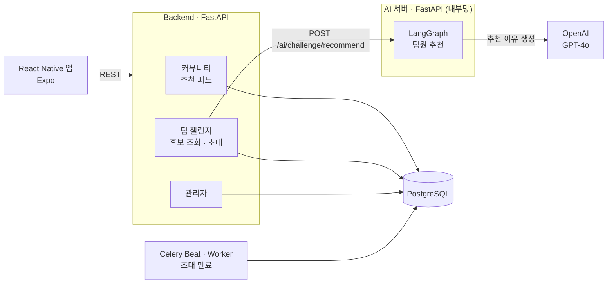
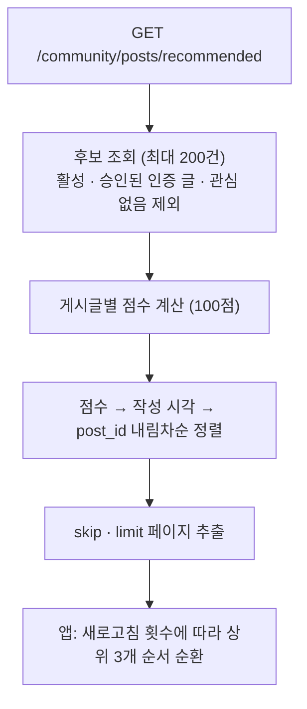
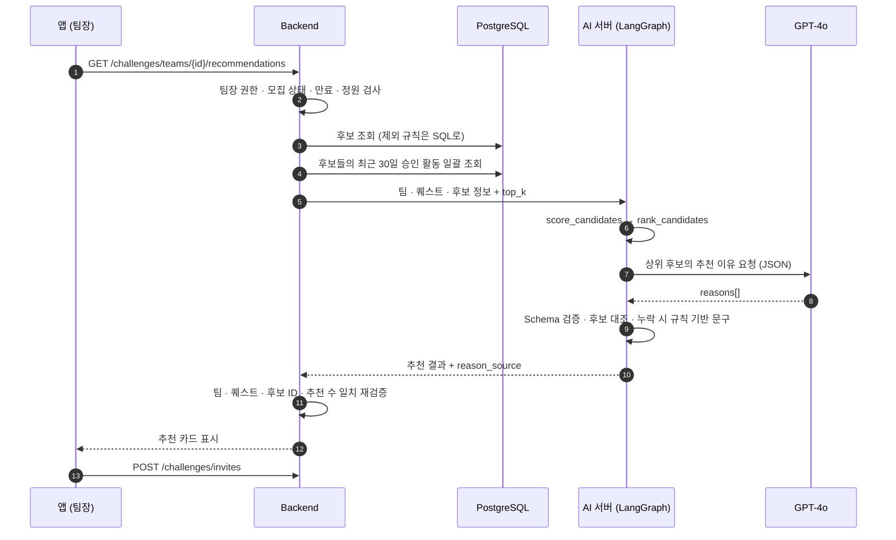
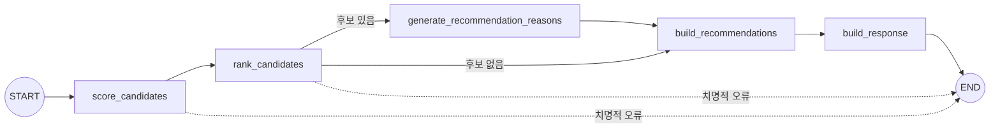

# GoodDeedQuest 기술 상세

[← GoodDeedQuest 소개로](README.md) · [소스코드](https://github.com/QuestismTeam/GoodDeedQuest)

> 팀 프로젝트 중 **제가 구현한 부분**(커뮤니티 · 팀 챌린지 · AI 팀원 추천 · 관리자)을 중심으로 정리했습니다.
> 코드 기준: `dev` 브랜치 · 담당 확인: 팀 역할표와 Git 커밋 이력.

### 목차

1. [개요와 개발 배경](#1-개요와-개발-배경)
2. [해결하려는 문제와 목표](#2-해결하려는-문제와-목표)
3. [기간 · 인원 · 담당 역할](#3-기간--인원--담당-역할)
4. [기술 스택과 선정 이유](#4-기술-스택과-선정-이유)
5. [시스템 아키텍처](#5-시스템-아키텍처)
6. [기능별 처리 흐름](#6-기능별-처리-흐름)
7. [API 구조](#7-api-구조)
8. [핵심 코드](#8-핵심-코드)
9. [기술적 문제와 해결](#9-기술적-문제와-해결)
10. [테스트와 검증](#10-테스트와-검증)
11. [배운 점과 개선할 부분](#11-배운-점과-개선할-부분)

---

## 1. 개요와 개발 배경

GoodDeedQuest(선행 퀘스트)는 선행을 게임의 퀘스트처럼 수행하고 보상받는 AI 기반 공익 플랫폼입니다.
AI가 맞춤 퀘스트를 추천하고, 사진으로 인증하면 경험치·포인트가 쌓이며, 커뮤니티와 팀 챌린지로 함께 실천합니다.

## 2. 해결하려는 문제와 목표

| 문제 | 제 담당 기능의 목표 |
|---|---|
| 인증 게시글이 많아지면 나와 관계없는 글에 묻힌다 | 사용자의 관심사·지역과 게시글 품질을 반영한 **개인화 피드** |
| 매번 같은 순서로 보이면 피드가 정체돼 보인다 | 점수 순서는 지키면서 새로고침마다 **상위 노출을 순환** |
| 함께할 팀원을 찾기 어렵다 | 팀의 퀘스트·지역·시간대에 맞는 **팀원 추천**과 이해하기 쉬운 **추천 이유** |
| LLM 응답은 형식이 틀리거나 없는 사람을 말할 수 있다 | LLM은 이유만 쓰게 하고, **검증·대체 문구**로 서비스가 멈추지 않게 |
| 운영자가 신고·사용자 상태를 관리할 화면이 필요하다 | 관리자 대시보드와 권한 검증 |

## 3. 기간 · 인원 · 담당 역할

- **기간** · 2026.06.26 ~ 2026.08.11 (K-Digital Training 중간 프로젝트)
- **인원** · 5명 (팀명 *퀘스트 지상주의*)
- **협업** · 기능 브랜치 → `dev` PR → CI 검증 → `main` 자동 승격

| 영역 | 담당 파일 (주요) |
|---|---|
| 커뮤니티 추천 | `backend/app/community/{scoring,service,repository,router}.py`, `frontend/src/screens/community/FeedScreen.tsx` |
| 팀 챌린지 | `backend/app/challenge/{service,repository,router,tasks}.py`, `frontend/src/screens/team/*` |
| AI 팀원 추천 | `ai/app/challenge_recommend/*` (LangGraph · 점수 · Prompt · LLM), `backend/app/challenge/ai_client.py` |
| 관리자 | `backend/app/admin/*`, `frontend/src/screens/admin/*` |

## 4. 기술 스택과 선정 이유

| 기술 | 선정 이유 |
|---|---|
| **FastAPI · SQLAlchemy 2.0** | 팀 공통 백엔드 표준. Router → Service → Repository로 나눠 기능별 담당자가 충돌 없이 작업 |
| **LangGraph** | 점수 계산 → 순위 → 이유 생성 → 응답 조립을 **노드**로 나누고, 후보 없음·오류 시 분기를 명시적으로 표현하기 위해 |
| **OpenAI GPT-4o (LangChain)** | 정해진 점수를 사람이 읽기 쉬운 한국어 추천 이유로 바꾸는 역할. `temperature=0`으로 결과 흔들림을 줄임 |
| **Pydantic** | LLM이 돌려준 JSON을 Schema로 검증해 형식이 틀리면 바로 대체 문구로 전환 |
| **Celery Beat** | 만료 시각이 지난 PENDING 초대를 매시간 일괄 정리 |
| **httpx (동기 Client)** | 백엔드가 동기 Session 구조라 AI 서버 호출도 동기로 맞추고, 연결·응답 시간 초과를 세분화 |

## 5. 시스템 아키텍처



앱은 백엔드와만 통신하고, AI 서버는 외부에 노출하지 않습니다. 팀 전체 배포 구조는 [팀 아키텍처 이미지](https://github.com/QuestismTeam/GoodDeedQuest/blob/dev/docs/architecture.jpg)를 참고하세요.

## 6. 기능별 처리 흐름

### 6-1. 커뮤니티 개인화 추천 피드



| 항목 | 배점 | 계산 방식 |
|---|:---:|---|
| 관심 카테고리 | 35 | 사용자 관심 카테고리에 게시글 퀘스트의 카테고리가 포함되면 35점 |
| 지역 | 15 | 사용자 지역명이 퀘스트 장소 문자열에 포함되면 15점 |
| 최신성 | 20 | 1일 이내 20 · 3일 16 · 7일 12 · 14일 8 · 30일 4 · 이후 0 |
| 반응도 | 15 | `좋아요 + 댓글 × 2` 값이 1·5·10·20 이상일 때 4·8·12·15점 |
| 작성자 신뢰도 | 15 | 신뢰도 0~100을 0~15점으로 환산 (정수 반올림) |

### 6-2. 팀 챌린지 → AI 팀원 추천



**후보에서 아예 빼는 사람 (SQL)** — 요청자 본인 · 비활성 사용자 · 관리자 · 같은 퀘스트의 다른 팀 참가자 · 이 팀에 대기·수락된 초대가 있는 사람 · 최근 7일 안에 이 팀 초대를 거절한 사람

**점수로 반영하는 기준 (AI 서버, 100점)** — 관심 카테고리 25 · 선호 난이도 15 · 활동 시간 15 · 지역 15 · 신뢰도 10 · 프로필 임베딩 유사도 10 · 연속 활동 5 · 레벨 5

맞지 않는 조건은 후보에서 빼지 않고 점수로만 반영해, 후보가 너무 적어지는 문제를 피했습니다.

**LangGraph 구성**



## 7. API 구조

| 영역 | Method · Path | 설명 |
|---|---|---|
| 커뮤니티 | `GET /community/posts/recommended` | 개인화 추천 피드 |
| | `POST /community/posts` | 승인된 인증으로 게시글 작성 |
| | `POST /community/posts/{id}/likes/toggle` · `/comments` · `/not-interested` · `/reports` | 좋아요 · 댓글 · 관심 없음 · 신고 |
| 팀 챌린지 | `POST /challenges/teams` · `GET /challenges/teams` · `GET /challenges/my-teams` | 팀 생성 · 목록 · 내 팀 |
| | `POST /challenges/teams/{id}/join` · `DELETE …/leave` | 참가(비공개 방 비밀번호) · 탈퇴 |
| | `GET /challenges/teams/{id}/recommendations` | **AI 팀원 추천** (top_k 1~5, 직전 추천 제외 가능) |
| | `POST /challenges/invites` · `PATCH /challenges/invites/{id}` | 초대 · 수락/거절 |
| AI 서버 | `POST /ai/challenge/recommend` | LangGraph 실행 (내부 호출 전용) |
| 관리자 | `/admin/*` | 대시보드 통계 · 접속 추이 · 사용자 · 신고 처리 |

## 8. 핵심 코드

### ① 추천 점수 — 순수 함수로 분리 (`community/scoring.py`)

```python
def calculate_engagement_score(*, like_count: int, comment_count: int) -> int:
    # 비정상적인 음수 집계값은 0으로 보정
    safe_like_count = max(like_count, 0)
    safe_comment_count = max(comment_count, 0)
    # 댓글은 좋아요보다 적극적인 반응이므로 2배 가중치
    engagement_value = safe_like_count + safe_comment_count * 2
    if engagement_value >= 20: return 15
    if engagement_value >= 10: return 12
    if engagement_value >= 5:  return 8
    if engagement_value >= 1:  return 4
    return 0
```

점수 계산 파일은 DB에 접근하지 않는 순수 함수만 둬서, 경계값을 단위 테스트로 바로 검증할 수 있게 했습니다.
같은 요청 안에서는 기준 시각(`reference_time`)을 하나로 고정해 게시글마다 최신성 기준이 달라지지 않게 했습니다.

### ② 점수 순서를 지키면서 피드에 변화 주기 (`FeedScreen.tsx`)

```ts
// Backend 추천 점수순 상위 후보는 유지하면서
// 상위 3개의 노출 순서만 새로고침 횟수에 따라 순환합니다.
function rotateRecommendedFeed(feeds: CommunityFeedItem[], rotationStep: number) {
  const poolSize = Math.min(RECOMMENDATION_ROTATION_SIZE, feeds.length);
  if (poolSize <= 1) return feeds;
  const offset = rotationStep % poolSize;
  if (offset === 0) return feeds;
  const topCandidates = feeds.slice(0, poolSize);
  return [...topCandidates.slice(offset), ...topCandidates.slice(0, offset), ...feeds.slice(poolSize)];
}
```

### ③ LLM은 "이유"만 — 검증과 대체 (`challenge_recommend/nodes.py`)

```python
for reason in reasons:
    if reason.user_id not in candidate_by_user_id:       # 후보에 없는 사람 → 무시
        warnings.append(f"후보 목록에 없는 user_id={reason.user_id}의 추천 이유를 무시했습니다.")
        continue
    if reason.user_id in valid_reason_by_user_id:         # 같은 사람 중복 → 하나만
        continue
    valid_reason_by_user_id[reason.user_id] = reason.model_copy(update={"reason_source": "LLM"})

for candidate in candidates:                              # 순위는 점수가 정한 순서 그대로
    generated = valid_reason_by_user_id.get(candidate.user_id)
    normalized.append(generated or build_rule_based_reason(candidate))  # 누락 → 규칙 기반 문구
```

- 순위와 점수는 코드가 결정하고, LLM은 이미 정해진 후보의 **설명 문장만** 씁니다.
- LLM 호출 실패·JSON 파싱 실패·Schema 불일치는 모두 예외로 올린 뒤, 노드에서 규칙 기반 문구로 바꿔 **응답은 항상 정상 형식**을 유지합니다.
- 응답에 `reason_source`(`LLM` / `FALLBACK`)를 남겨 화면과 로그에서 출처를 구분할 수 있습니다.

### ④ Prompt 설계 원칙 (`challenge_recommend/prompts.py`)

- **개인정보 최소화** · 위도·경도, 임베딩 원본 벡터, 프로필 이미지 URL, 요청자 ID는 Prompt에 넣지 않습니다.
- **Prompt Injection 방어** · 팀명·퀘스트 설명·닉네임은 신뢰하지 않는 데이터로 보고 JSON으로 직렬화해 구분 태그 안에 넣고, 그 안의 지시는 따르지 않도록 System Prompt에 명시합니다.
- **출력 형식 고정** · Markdown 없이 `{"reasons": [...]}` JSON 하나만 반환하도록 요구합니다.

### ⑤ 후보 제외는 SQL, 적합도는 점수로 (`challenge/repository.py`)

```python
.where(
    User.user_id != requester_id,
    User.is_active.is_(True),
    User.role == UserRole.USER,
    ~same_quest_member_exists,      # 같은 퀘스트의 다른 팀 참가자
    ~unavailable_invite_exists,     # 대기·수락 초대, 최근 7일 거절
)
```

## 9. 기술적 문제와 해결

| # | 문제 | 원인 · 시도 | 해결 | 결과 |
|:-:|---|---|---|---|
| 1 | 팀원 추천 요청이 DB 오류로 실패 | 팀·퀘스트·카테고리 **엔티티 전체**로 `GROUP BY`를 걸어 PostgreSQL이 집계 쿼리를 거부 | 각 테이블의 **PK로만 그룹화**하도록 수정 (#192) | 추천 컨텍스트 조회 정상화 |
| 2 | 프로필 임베딩 요청이 형식 오류로 실패 | 관심 카테고리·활동 시간 JSON에 숫자와 문자열이 섞여 AI 서버 Schema와 불일치 | 전송 전에 문자열 목록으로 정규화 (#192) | 임베딩 요청 형식 일치 |
| 3 | 커뮤니티 영상이 모바일에서 자주 끊김 | 인증 원본 영상을 그대로 재생해 용량·비트레이트가 큼 | 게시 시 **480p H.264**(CRF 30, 최대 900kbps)로 변환한 별도 파일을 재생, 앱의 버퍼 설정 조정 (#230) | 인증 원본과 재생용 파일 분리 |
| 4 | 시간이 지나면 커뮤니티 사진이 사라질 위험 | 인증 미디어는 30일 만료 정책 대상 | 게시 시 S3 객체를 `community/` 경로로 **실제 복사**해 영구 보관 | 게시글 미디어 보존 |
| 5 | 추천 피드가 항상 같은 순서로 보임 | 점수가 결정적이라 새로고침해도 결과가 동일 | 점수 정렬은 서버가 유지하고, 앱이 **상위 3개만 순환** | 순서 품질과 변화를 함께 확보 |
| 6 | LLM 응답을 신뢰할 수 없음 | 형식 오류, 후보에 없는 사용자, 중복, 누락 가능성 | Schema 검증 + 후보 대조 + 규칙 기반 대체 + 백엔드 재검증 | LLM 장애에도 추천 기능 유지 |
| 7 | 관리자 기능만 비동기 코드라 구조가 달랐음 | 프로젝트 공통 DB 세션은 동기 방식 | 관리자 Router·Service·Repository·테스트를 **동기 방식으로 통일** (#102) | 의존성·테스트 방식 일관화 |

## 10. 테스트와 검증

| 대상 | 테스트 파일 | 결과 |
|---|---|---|
| AI 추천 이유 생성 · 파싱 | `ai/app/challenge_recommend/test/test_llm_reason_generator.py` | **7개 통과** |
| 팀 챌린지 · 추천 후보 조회 | `backend/app/challenge/test/*` | **19개 통과** |
| 커뮤니티 (피드 · 점수 · 미디어 보존) | `backend/app/community/test/*` | **47개 통과** |
| 관리자 | `backend/app/admin/test_admin.py` | **17개 통과** |

<sub>2026-10-13 로컬 데모 환경에서 `pytest`로 다시 실행한 결과입니다 (총 90개). 테스트에서는 LLM을 가짜 Chat Model로 주입해 실제 API를 호출하지 않습니다.</sub>

**실제 LLM 호출 확인** — 시연 GIF 녹화 시 실제 GPT-4o를 호출했고, 응답 5건 모두 `reason_source: "LLM"`, 경고(`warnings`) 0건이었습니다. LLM 응답 대기는 약 8초였습니다.

<sub>추천 알고리즘의 정확도·만족도처럼 사용자 데이터가 필요한 지표는 측정하지 않았습니다.</sub>

## 11. 배운 점과 개선할 부분

**배운 점**

- LLM을 서비스에 넣을 때 가장 중요한 것은 **책임 범위를 좁히는 것**이었습니다. 순위는 코드가, 설명은 LLM이 맡도록 나누니 검증과 대체 처리가 단순해졌습니다.
- 점수 계산을 순수 함수로 분리하면 배점을 바꿔도 테스트로 바로 확인할 수 있습니다.
- 하드 제외 조건과 소프트 점수 조건을 구분해야 후보 부족 문제 없이 품질을 조정할 수 있습니다.

**개선할 부분**

- **관심 카테고리 저장 형식 불일치** · 포트폴리오를 정리하며 다시 확인해 보니, 회원가입은 카테고리 *코드*(`environment` 등)를 저장하고 커뮤니티 점수는 카테고리 *ID*와 비교합니다. 이 상태에서는 커뮤니티 피드의 카테고리 35점이 반영되지 않을 수 있어, 저장 형식을 하나로 맞추고 테스트를 추가해야 합니다.
- LLM 응답 대기(약 8초) 동안 사용자가 기다려야 합니다. 같은 팀의 추천 결과 캐시나 이유 생성 비동기화를 검토할 수 있습니다.
- 배점은 기획 기준으로 정했고 실제 사용자 반응으로 검증하지 못했습니다. 클릭·초대 수락 데이터를 쌓아 가중치를 조정하는 단계가 필요합니다.

[← GoodDeedQuest 소개로](README.md) · [포트폴리오 목록으로](../../README.md)
