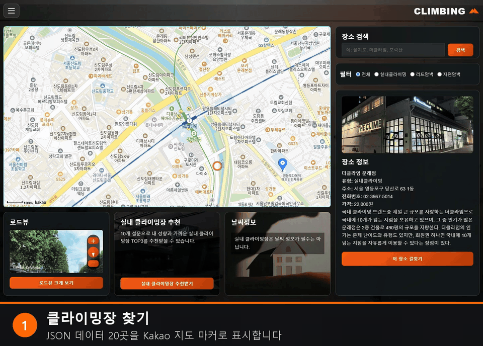
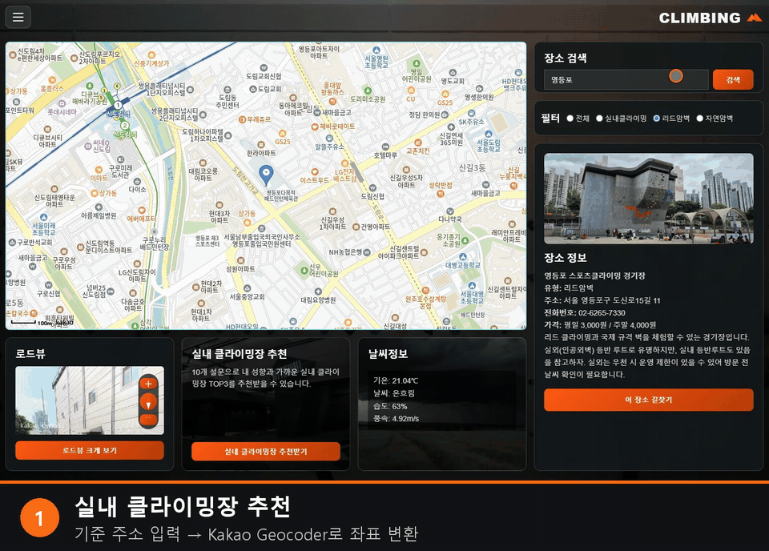
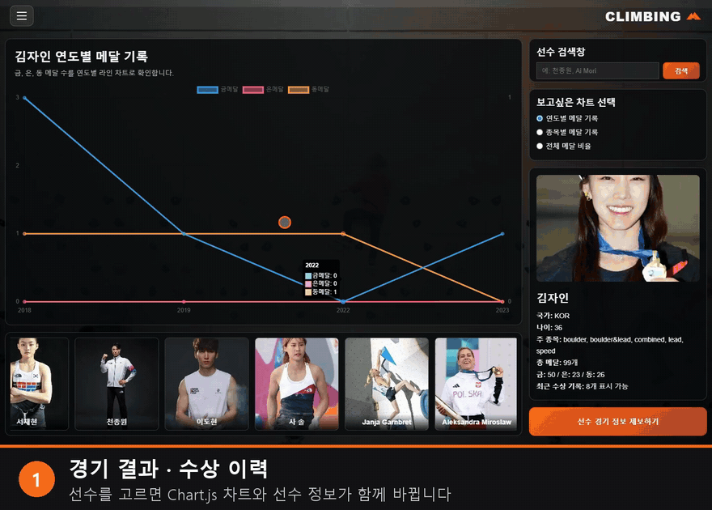
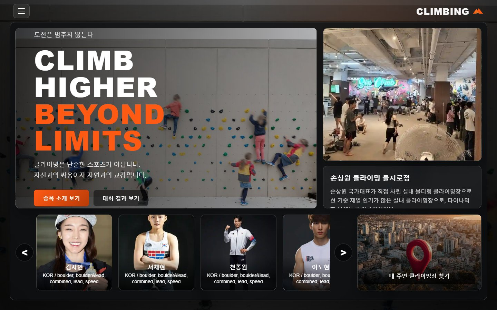
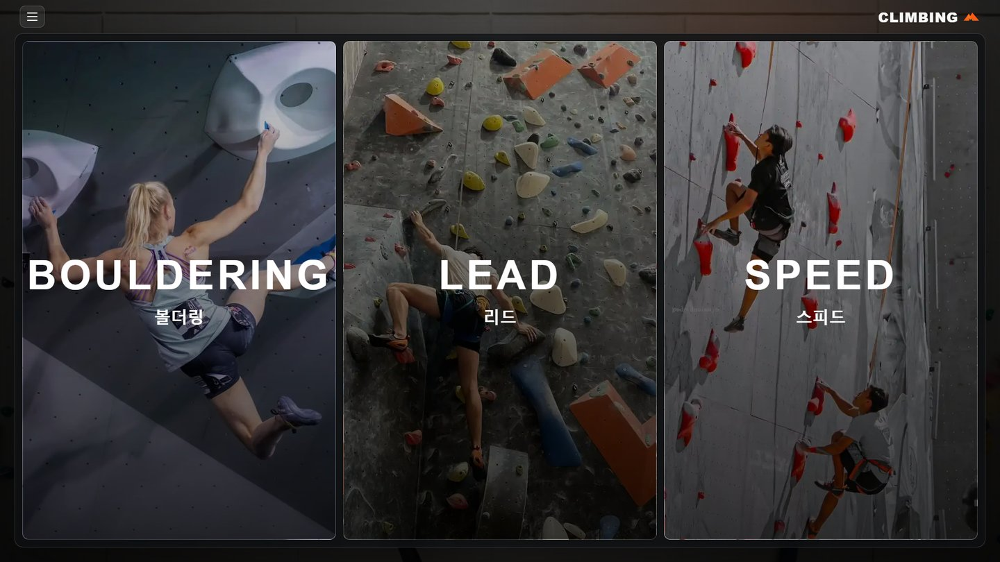
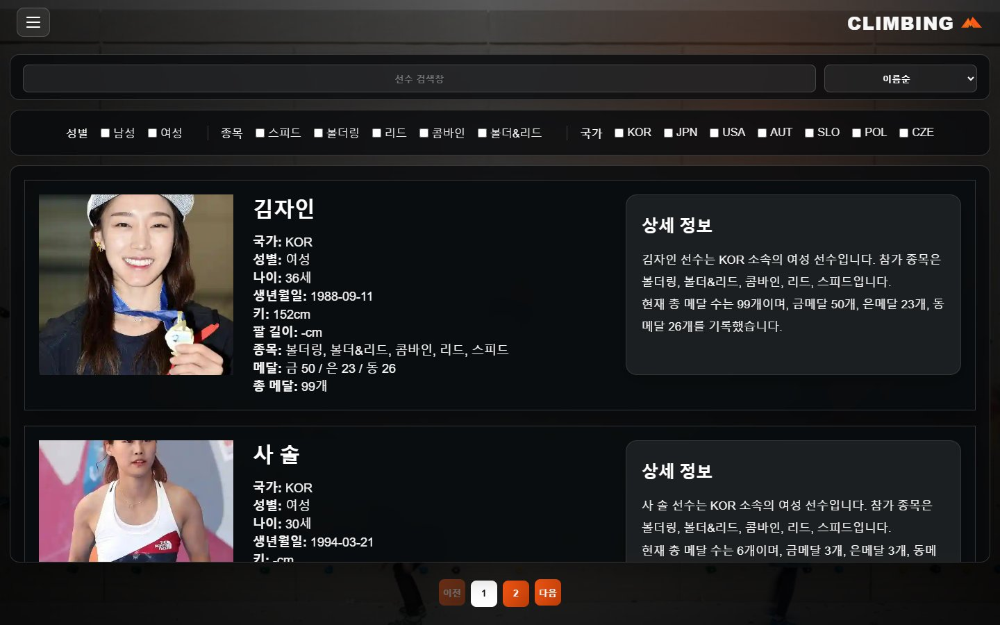
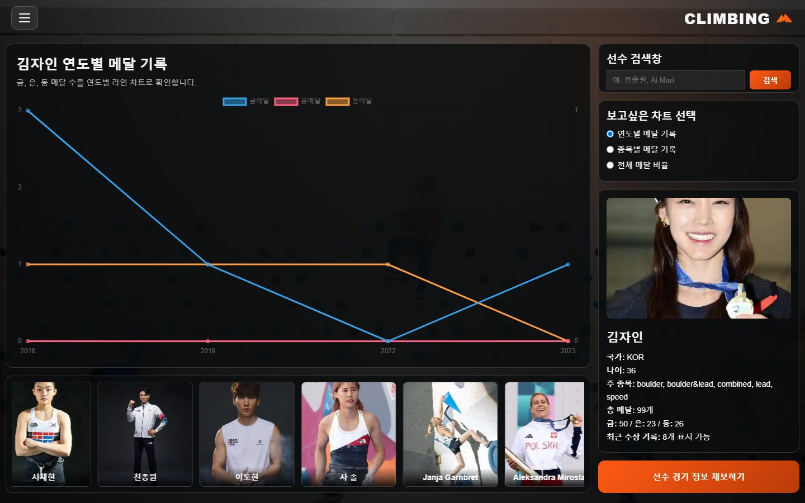

# Climbing Web · 클라이밍장 · 선수 정보 웹사이트

> **클라이밍 종목 소개 · 클라이밍장 찾기와 추천 · 선수 기록**을 한곳에서 볼 수 있는 5페이지 웹사이트입니다.
> 화면 설계서 작성부터 HTML · CSS · JavaScript 구현까지 **혼자 진행**했습니다.

`개인 프로젝트` · `1인` · `2026.05` · `프로젝트명: CLIMB HIGHER BEYOND LIMITS`

 

## 시연 1 · 클라이밍장 찾기 — 지도 · 필터 · 로드뷰 · 실시간 날씨

**무엇을 하나요** — 클라이밍장 20곳(실내 15 · 리드암벽 2 · 자연암벽 3)을 Kakao 지도에 표시하고, 유형 필터와 키워드로 좁혀 장소 정보 · 로드뷰 · 날씨를 함께 보여줍니다.

**이 장면을 보세요** (하단 자막 번호와 같음)
1. 첫 화면 — JSON 데이터 20곳을 마커로 표시하고 첫 번째 장소를 자동 선택
2. **리드암벽** 필터 — 마커가 2곳으로 줄고 지도 범위가 두 마커에 맞춰짐
3. `영등포` 검색 — 결과가 1곳이라 바로 선택, 장소 사진 · 주소 · 가격 표시
4. 야외 암벽이므로 **OpenWeather 현재 날씨**(기온 · 습도 · 풍속)를 불러오고 날씨에 맞춰 배경 이미지가 바뀜
5. **로드뷰 크게 보기** — 장소 반경 80m 안의 로드뷰를 팝업으로 확대

[고화질 MP4](../../assets/03-climbing-web/01_gym_map_search.mp4) · [구현 상세 →](TECHNICAL.md#4-1-클라이밍장-찾기-지도--필터--날씨)

 

## 시연 2 · 성향 설문 10문항 → 실내 클라이밍장 TOP 3 추천

**무엇을 하나요** — 기준 주소와 10문항 설문 답변으로 실내 클라이밍장 15곳에 점수를 매겨 **TOP 3**를 추천합니다.

**이 장면을 보세요**
1. 기준 주소 입력 → **Kakao Geocoder**가 주소를 좌표로 변환 (주소 없이 추천받기도 가능)
2. 설문 10문항 — 답변마다 `beginner` · `access` 같은 **성향 태그에 1점** (2배속)
3. 결과 TOP 3 — 세 곳 모두 일치 점수 7점으로 같아서, **입력 주소와 가까운 순**(0.4km → 3.2km → 7.6km)으로 정렬
4. **지도에서 보기** — 추천된 곳으로 지도 · 장소 정보 · 로드뷰가 바뀜

[고화질 MP4](../../assets/03-climbing-web/02_gym_recommend.mp4) · [추천 점수 계산 →](TECHNICAL.md#4-2-성향-설문-추천-top-3)

 

## 시연 3 · 선수 기록 차트 → 선수 상세 이동 · 필터

**무엇을 하나요** — 선수 15명의 수상 기록을 **Chart.js 차트 3종**으로 보여주고, 선수 소개 페이지의 해당 선수 위치로 바로 이동합니다.

**이 장면을 보세요**
1. 영문 이름 `Tomoa` 로 검색 → 선수 정보와 차트가 함께 바뀜
2. 차트 종류 전환 — **연도별 라인** → **종목별 누적 막대** → **전체 비율 도넛**
3. **선수 자세히 보기** — `?player=2276` 으로 이동해 해당 선수가 있는 **2페이지를 계산**하고 카드로 스크롤 · 강조
4. 국가 `KOR` 필터 + **메달 많은순** 정렬

[고화질 MP4](../../assets/03-climbing-web/03_results_chart_players.mp4) · [구현 상세 →](TECHNICAL.md#4-3-선수-기록-차트와-선수-상세-이동)

 

## 다른 화면

<table>
<tr>
<td width="50%"></td>
<td width="50%"></td>
</tr>
<tr>
<td><b>메인</b> — 인기 클라이밍장 4곳을 3초마다 넘기는 슬라이드, 선수 카드 슬라이드와 정보 팝업</td>
<td><b>종목 소개</b> — 카드를 누르면 그 카드만 펼쳐지고 종목 설명과 YouTube 영상이 나타남</td>
</tr>
<tr>
<td></td>
<td></td>
</tr>
<tr>
<td><b>선수 소개</b> — 이름 · 국가 실시간 검색, 정렬 5가지, 성별 · 종목 · 국가 필터, 10명씩 페이지 나눔</td>
<td><b>경기 결과</b> — 차트 · 선수 정보 · 하단 선수 카드가 무한히 흐르는 띠, 경기 정보 제보 폼</td>
</tr>
</table>

 

## 무엇을 만들었나요

| 페이지 | 구현한 기능 |
|---|---|
| **메인** | 인기 클라이밍장 자동 슬라이드(3초), 선수 카드 좌우 슬라이드 · 클릭 시 정보 팝업, 클라이밍장 찾기 바로가기 |
| **종목 소개** | 볼더링 · 리드 · 스피드 카드, 하나만 펼치는 상세 보기, 펼칠 때 YouTube 영상 삽입 · 접을 때 제거 |
| **클라이밍장 찾기** | Kakao 지도 · 마커, 키워드 검색 + 유형 필터, 장소 정보 · 길찾기 링크, 로드뷰 · 크게 보기, 야외 장소 실시간 날씨, **성향 설문 추천 TOP 3** |
| **선수 소개** | 실시간 검색, 정렬 5가지, 체크박스 필터 3종, 페이지네이션, 다른 페이지에서 넘어온 선수로 이동 · 강조 |
| **경기 결과** | 한글 · 영문 이름 검색, Chart.js 차트 3종 전환, 선수 정보 패널, 경기 정보 제보 폼(입력 확인까지, 전송 기능 없음) |
| **공통** | 왼쪽 슬라이드 메뉴(현재 페이지 표시 · Esc로 닫기), 페이지별 CSS 분리 |

서버 없이 브라우저에서만 동작하는 정적 웹사이트입니다. 데이터는 JSON 파일 4개(선수 15명 · 수상 기록 15명 · 경기 결과 328건 · 클라이밍장 20곳)로 가공해 `fetch` 로 불러옵니다.

 

## 기술 스택

| 구분 | 기술 |
|---|---|
| Frontend | HTML · CSS · JavaScript (프레임워크 · 빌드 도구 없이 직접 작성) |
| 지도 | Kakao Maps JavaScript API — 지도 · 마커 · 주소 → 좌표 변환(Geocoder) · 로드뷰 |
| 외부 API | OpenWeather 현재 날씨 API |
| 차트 · 영상 | Chart.js · YouTube 임베드 |
| 데이터 | JSON (선수 · 수상 기록 · 경기 결과 · 클라이밍장) |
| 설계 | 화면 흐름도 · 화면별 설계서 (PDF 15쪽) |

 

## 더 보기

- 📘 **[기술 상세 문서](TECHNICAL.md)** — 페이지 구조, 추천 점수 계산, 선수 위치 계산, 설계 대비 구현 상태, 개선할 점
- 💻 소스코드 — 현재 비공개입니다.
- 🌐 서비스 링크 — 배포하지 않았습니다.

시연 GIF는 2026-10-13 로컬 정적 서버에서 원본 코드를 그대로 실행해 녹화했습니다. 지도 · 로드뷰 · 날씨는 녹화 당시 실제 API 응답이며, 마우스 위치 표시와 하단 자막은 편집 단계에서 추가했습니다.

 

[← 포트폴리오 목록으로](../../README.md)
