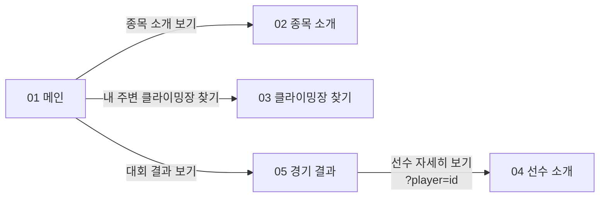
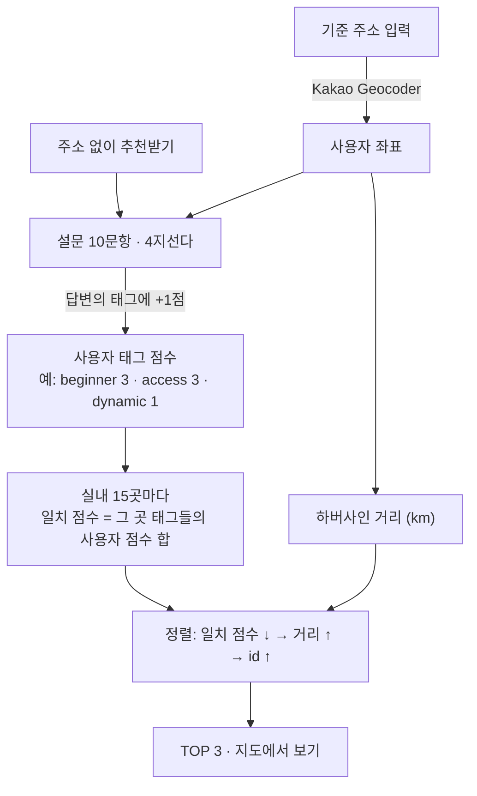

# Climbing Web 기술 상세

[← Climbing Web 소개로](README.md)

> 프로젝트 파일(HTML 5개 · CSS 7개 · JavaScript 8개 · JSON 4개)과 화면 설계서 PDF를 기준으로 정리했습니다.
> 문서에 적은 동작은 2026-10-13에 원본 코드를 로컬 정적 서버에서 그대로 실행해 확인했습니다.

### 목차

1. [개요](#1-개요)
2. [페이지 구조와 데이터 흐름](#2-페이지-구조와-데이터-흐름)
3. [기술 스택과 사용 방식](#3-기술-스택과-사용-방식)
4. [기능별 처리 흐름](#4-기능별-처리-흐름)
5. [데이터 구성](#5-데이터-구성)
6. [핵심 코드](#6-핵심-코드)
7. [구현하며 해결한 점](#7-구현하며-해결한-점)
8. [설계 대비 구현 상태](#8-설계-대비-구현-상태)
9. [실행 확인](#9-실행-확인)
10. [개선할 점](#10-개선할-점)

---

## 1. 개요

| 항목 | 내용 |
|---|---|
| 프로젝트명 | CLIMB HIGHER BEYOND LIMITS (서비스명: 클라이밍 장소 및 선수검색) |
| 형태 | 개인 프로젝트 · 1인 (화면 설계 · 디자인 · 구현) |
| 기간 | 2026년 5월 (코드 파일 수정일 2026-05-25 ~ 05-28) |
| 구성 | 메인 · 종목 소개 · 클라이밍장 찾기 · 선수 소개 · 경기 결과 — 5페이지 |
| 동작 방식 | 서버 없는 정적 웹사이트. JSON 데이터를 `fetch` 로 읽고, 지도 · 날씨는 브라우저에서 외부 API를 직접 호출 |

## 2. 페이지 구조와 데이터 흐름



<sub>모든 페이지는 왼쪽 슬라이드 메뉴로도 서로 이동할 수 있습니다.</sub>

| 페이지 | 읽는 데이터 | 외부 서비스 |
|---|---|---|
| 01 메인 | `01_players.json`, JS 안의 인기 클라이밍장 4곳 | — |
| 02 종목 소개 | HTML에 직접 작성한 종목 설명 | YouTube 임베드 |
| 03 클라이밍장 찾기 | `04_gyms.json`, 성향 태그(`07`), 설문 문항(`08`) | Kakao Maps SDK (지도 · Geocoder · 로드뷰), OpenWeather |
| 04 선수 소개 | `01_players.json` | — |
| 05 경기 결과 | `01_players.json`, `03_awards.json`, `02_results.json`(불러오기만 하고 화면에는 쓰지 않음) | Chart.js |

- 모든 페이지는 `common.css` + 페이지별 CSS, 페이지별 JS + 공통 JS(`01_common.js`: 현재 메뉴 표시 · 메뉴 열기/닫기 · Esc 닫기)로 구성됩니다.
- 페이지 사이에서 넘기는 값은 URL 쿼리 하나(`04_players.html?player=<선수 id>`)뿐입니다.

## 3. 기술 스택과 사용 방식

| 기술 | 어디에 어떻게 썼나 |
|---|---|
| HTML · CSS · JavaScript | 프레임워크 · 빌드 도구 없이 작성. 목록 · 카드 · 팝업은 데이터를 받아 템플릿 문자열로 만들어 넣음 |
| Kakao Maps JavaScript API | `Map` · `Marker` · `LatLngBounds`(검색 결과에 맞춰 지도 범위 조정), `services.Geocoder`(주소 → 좌표), `Roadview` · `RoadviewClient`(가까운 로드뷰 찾기) |
| OpenWeather API | 현재 날씨(`/data/2.5/weather`) — 기온 · 날씨 설명 · 습도 · 풍속, 날씨 종류에 따라 배경 이미지 변경 |
| Chart.js | 라인(왼쪽 · 오른쪽 y축 2개) · 누적 막대 · 도넛 차트, 차트를 바꿀 때 이전 차트를 `destroy()` 후 다시 그림 |
| CSS | `grid-template-columns` 전환으로 종목 카드 펼치기, `@keyframes` 로 무한히 흐르는 선수 카드 띠와 배경 움직임 |

## 4. 기능별 처리 흐름

### 4-1. 클라이밍장 찾기 (지도 · 필터 · 날씨)

1. `04_gyms.json` 을 읽어 성향 태그(`07_climbingData.js`)를 id로 합친 뒤, 20곳 전체를 마커로 표시하고 첫 장소를 선택합니다.
2. 검색은 **유형 필터**(전체 · 실내클라이밍 · 리드암벽 · 자연암벽)와 **키워드**(이름 · 주소 · 유형 포함 여부)를 함께 적용합니다. 검색어가 비어 있으면 필터만 적용하고, 결과가 1곳이면 바로 선택합니다.
3. 장소를 선택하면 지도를 그 위치로 옮기고 장소 정보 · 길찾기 버튼(카카오맵 길찾기 링크)을 그린 뒤,
   - `RoadviewClient.getNearestPanoId(위치, 80m)` 로 가까운 로드뷰를 찾아 표시하고,
   - 유형이 **리드암벽 · 자연암벽**이면 OpenWeather를 호출해 날씨와 배경 이미지를 바꿉니다. 실내는 날씨를 부르지 않습니다.

### 4-2. 성향 설문 추천 TOP 3



- 태그는 `beginner` · `challenge` · `clean` · `popular` · `dynamic` · `access` 등 15종이고, 실내 15곳마다 3~5개가 붙어 있습니다.
- 주소를 입력하지 않으면 거리 없이 일치 점수와 id 순으로만 정렬합니다.
- 시연에서는 세 곳의 일치 점수가 모두 7점이어서 거리(0.4km · 3.2km · 7.6km) 순으로 순위가 정해졌습니다.

### 4-3. 선수 기록 차트와 선수 상세 이동

1. 경기 결과 페이지는 `01_players.json` · `02_results.json` · `03_awards.json` 을 `Promise.all` 로 함께 읽고 첫 선수를 선택합니다.
2. 검색은 한글 이름(선수 데이터)과 영문 이름(수상 데이터)을 **소문자 · 공백 제거**로 맞춘 뒤 포함 여부로 찾습니다. 빈 검색어나 없는 선수는 알림을 띄웁니다.
3. 차트 데이터는 수상 기록에서 바로 계산합니다.
   - 연도별: 최근 메달 목록을 시즌별 금 · 은 · 동 개수로 집계
   - 종목별: 종목별 요약(`disciplineSummary`)을 누적 막대로
   - 전체 비율: 금 · 은 · 동 합계를 도넛으로
4. **선수 자세히 보기** → `04_players.html?player=<id>`. 선수 소개 페이지는 현재 검색 · 필터 · 정렬이 적용된 목록에서 그 선수의 순서를 찾아 **몇 페이지인지 계산**하고, 카드로 스크롤한 뒤 2.5초 동안 테두리로 강조합니다.

### 4-4. 종목 소개 카드

- 카드를 누르면 다른 카드의 펼침과 영상을 모두 정리한 뒤, 누른 카드만 펼치고 0.35초 뒤 YouTube 영상을 넣습니다(자동 재생 · 음소거).
- 영상은 펼친 카드에만 존재하도록, 접거나 다른 카드를 열 때 `iframe` 을 지웁니다.

## 5. 데이터 구성

| 파일 | 주요 항목 | 건수 | 사용 페이지 |
|---|---|:-:|---|
| `01_players.json` | 이름 · 국가 · 성별 · 나이 · 생년월일 · 키 · 팔 길이 · 종목 · 금/은/동 · 이미지 | 15명 | 메인 · 선수 소개 · 경기 결과 |
| `02_results.json` | 선수 · 순위 · 종목 · 시즌 · 날짜 · 대회 장소 | 328건 | 경기 결과 (불러오기만 함) |
| `03_awards.json` | 선수별 메달 합계 · 종목별 집계 · 최근 메달 목록 | 15명 | 경기 결과 |
| `04_gyms.json` | 이름 · 유형 · 주소 · 위도/경도 · 전화 · 가격 · 설명 · 이미지 | 20곳 | 클라이밍장 찾기 |
| `07_climbingData.js` | 실내 클라이밍장별 성향 태그 | 15곳 | 클라이밍장 찾기 |
| `08_questionData.js` | 설문 문항 · 선택지별 태그 | 10문항 | 클라이밍장 찾기 |

## 6. 핵심 코드

### ① 추천 점수와 정렬 (`js/04_gyms.js`)

```js
const scoredGyms = indoorGyms.map(function (gym) {
    let matchScore = 0;
    const tags = gym.tags || [];            // 태그가 없는 곳도 오류 없이 0점
    tags.forEach(function (tag) {
        if (userScore[tag]) matchScore += userScore[tag];
    });
    let distance = null;
    if (position) distance = getDistance(position.lat, position.lng, gym.lat, gym.lng);
    return { ...gym, matchScore: matchScore, distance: distance };
});

scoredGyms.sort(function (a, b) {
    if (b.matchScore !== a.matchScore) return b.matchScore - a.matchScore;   // 성향 일치 우선
    if (a.distance !== null && b.distance !== null) return a.distance - b.distance; // 동점이면 가까운 곳
    return a.id - b.id;
});
return scoredGyms.slice(0, 3);
```

### ② 두 좌표 사이 거리 — 하버사인 공식 (`js/04_gyms.js`)

```js
function getDistance(lat1, lng1, lat2, lng2) {
    const R = 6371;                                   // 지구 반지름(km)
    const dLat = (lat2 - lat1) * Math.PI / 180;
    const dLng = (lng2 - lng1) * Math.PI / 180;
    const a = Math.sin(dLat / 2) ** 2 +
              Math.cos(lat1 * Math.PI / 180) * Math.cos(lat2 * Math.PI / 180) * Math.sin(dLng / 2) ** 2;
    return R * 2 * Math.atan2(Math.sqrt(a), Math.sqrt(1 - a));
}
```

<sub>원본은 `Math.sin(x) * Math.sin(x)` 형태이며, 여기서는 읽기 쉽게 `** 2` 로 줄여 적었습니다.</sub>

### ③ 다른 페이지에서 넘어온 선수의 페이지 계산 (`js/05_players.js`)

```js
const targetIndex = filteredPlayers.findIndex(player => {
    return String(player.id) === String(playerId);   // URL 값은 문자열이라 둘 다 문자열로 비교
});
if (targetIndex === -1) return;

currentPage = Math.floor(targetIndex / playersPerPage) + 1;   // 한 페이지 10명
renderPlayers();
// 카드 위치로 스크롤한 뒤 highlight 클래스를 2.5초 동안 붙임
```

### ④ 연도별 메달 집계 (`js/06_results.js`)

```js
award.recentMedals.forEach(function (medal) {
    const year = medal.season;
    if (!yearMap[year]) yearMap[year] = { gold: 0, silver: 0, bronze: 0 };
    yearMap[year][medal.medal]++;
});
const years = Object.keys(yearMap).sort();
```

### ⑤ 날씨 종류 → 배경 (`js/04_gyms.js`)

```js
const key = String(weatherMain || "default").toLowerCase();
if (["clear", "clouds", "rain", "drizzle", "thunderstorm", "snow"].includes(key)) {
    weatherBox.classList.add(`weather-${key}`);
} else if (["mist", "smoke", "haze", "dust", "fog", "sand", "ash", "squall", "tornado"].includes(key)) {
    weatherBox.classList.add("weather-mist");
} else if (key === "indoor") {
    weatherBox.classList.add("weather-indoor");
} else {
    weatherBox.classList.add("weather-default");
}
```

## 7. 구현하며 해결한 점

코드 주석에 남긴 내용 중 동작에 영향을 준 것들입니다.

| 상황 | 처리 |
|---|---|
| 종목 카드 안의 **접기** 버튼을 누르면 클릭이 카드로 전달되어 다시 펼쳐짐 | `event.stopPropagation()` 으로 전달을 막고 전체 카드를 초기 상태로 |
| 다른 종목을 열어도 이전 영상이 계속 재생될 수 있음 | 카드를 열거나 접을 때 모든 영상 `iframe` 을 지운 뒤 필요한 카드에만 다시 삽입 |
| URL의 선수 id는 문자열, 데이터의 id는 숫자라 `===` 비교가 실패 | 둘 다 `String()` 으로 바꿔 비교 |
| 하단 선수 카드 띠가 끝에서 끊겨 보임 | 같은 카드 목록을 두 번 이어 붙이고 `translateX(-50%)` 까지 반복 이동 |
| 같은 canvas에 차트를 다시 만들 때 이전 차트가 남아 있음 | 새로 그리기 전에 기존 Chart 객체를 `destroy()` |
| 창 크기를 바꾸면 차트 · 선수 슬라이드 위치가 어긋남 | `resize` 이벤트에서 차트 크기와 슬라이드 이동 거리를 다시 계산 |
| 메인 첫 화면에서 클라이밍장 사진 영역이 잠깐 비어 보임 | 슬라이드를 만들기 전에 첫 번째 이미지를 배경으로 먼저 지정 |

## 8. 설계 대비 구현 상태

화면 설계서(PDF)의 항목과 실제 코드를 비교했습니다. ✅ 구현 · 🔸 일부/변경 · ❌ 미구현

| 화면 | 설계 항목 | 구현 | 비고 |
|---|---|:-:|---|
| 메인 | 인기 클라이밍장 사진 · 정보 | ✅ | 4곳 자동 슬라이드 |
| 메인 | 유명 선수 목록 · 클릭 시 정보 팝업 | ✅ | |
| 메인 | 현재 위치 기반 클라이밍 명소 찾기 버튼 | 🔸 | 클라이밍장 찾기 페이지로 이동만 함 (현재 위치는 사용하지 않음) |
| 종목 소개 | 종목별 경기 방식 · 이미지, 클릭 시 상세 | ✅ | 상세에 YouTube 영상 추가 |
| 클라이밍장 찾기 | 카카오맵 · 장소 검색 · 유형 필터 · 장소 정보 | ✅ | 결과 없음 안내 포함, 길찾기 링크 추가 |
| 클라이밍장 찾기 | 로드뷰 · 확대 팝업 | ✅ | |
| 클라이밍장 찾기 | 성향 설문 10문항 · TOP 3 (주소 기준 / 주소 없이) | ✅ | |
| 클라이밍장 찾기 | 야외 장소 실시간 날씨 | ✅ | |
| 선수 정보 | 실시간 검색 · 정렬 · 체크박스 필터 · 상세 정보 | ✅ | 페이지네이션, 결과 페이지에서 이동 · 강조 추가 |
| 경기 결과 | 선수 검색(필수 입력 · 없는 선수 알림) · 차트 3종 선택 | ✅ | |
| 경기 결과 | 선수 사진 · 정보, 자세히 보기, 핵심 선수 미리보기 | ✅ | |
| 경기 결과 | 선수 경기 정보 제보 form | 🔸 | 설계는 모든 항목 필수 / 구현은 선수 이름 · 제보 내용만 확인, 전송 기능 없음 |
| 경기 결과 | 연도별 종목별 결과 표 · 순위표 (화면 흐름도) | ❌ | 경기 결과 데이터는 불러오지만 표로 그리지 않음 |

## 9. 실행 확인

- **방법**: 원본 파일을 수정하지 않고 로컬 정적 서버(`http://127.0.0.1:5500`)에서 Chrome으로 실행
- **결과**: 5페이지 모두 데이터 로딩 정상. Kakao 지도 SDK · 지도 타일 · 로드뷰 · 주소 검색, OpenWeather 날씨 응답 모두 성공(HTTP 200)
- **자동화 테스트**: 없음. 위 시연 장면처럼 브라우저에서 기능을 직접 조작해 확인했습니다.

## 10. 개선할 점

1. **API 키 분리** — OpenWeather 키가 JavaScript 코드에, Kakao JavaScript 키가 HTML에 그대로 들어 있습니다. Kakao JavaScript 키는 브라우저용 키로 사이트 도메인 등록으로 사용처를 제한하지만, OpenWeather 키는 서버(또는 서버리스 함수)를 거쳐 호출하도록 옮겨야 합니다. 소스코드를 공개하기 전에 먼저 정리할 부분입니다.
2. **반응형** — 미디어 쿼리가 없어 데스크톱 화면 기준으로만 배치됩니다. 1440px 폭에서는 종목 소개의 `BOULDERING` 제목이 카드 밖으로 넘칩니다(소개 페이지의 종목 화면은 1920px로 캡처).
3. **경기 결과 데이터 활용** — `02_results.json`(328건)을 불러오지만 화면에 쓰지 않습니다. 설계서의 결과 표 · 순위표를 이 데이터로 완성할 수 있습니다.
4. **작은 버그**
   - 검색 결과가 없을 때 지정한 기본 이미지 경로(`./images/gyms/default.webp`)가 실제 파일 위치(`./images/default.webp`)와 달라 이미지가 깨집니다.
   - 로드뷰가 없는 장소를 고르면 안내 문구만 바뀌고 이전 장소의 로드뷰가 그대로 남습니다.
5. **코드 정리** — 메뉴 열기 · 닫기 코드가 페이지별 JS와 공통 JS에 중복되어 같은 이벤트가 두 번 등록됩니다. Chart.js는 CDN 주소에 버전을 고정하지 않았습니다.

<br>

[← Climbing Web 소개로](README.md) · [포트폴리오 목록으로](../../README.md)
